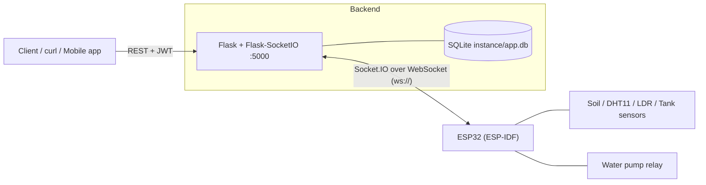
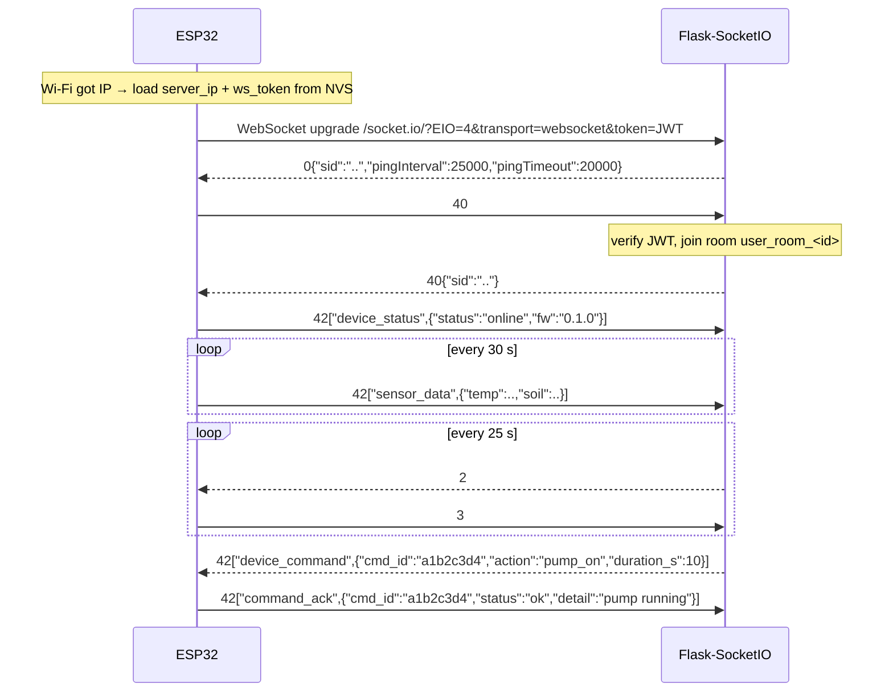

# LiveLeaf — Backend & Device Channel Documentation

LiveLeaf is an automatic irrigation device. This repository contains the **Flask backend** (REST API + Socket.IO channel) that talks to the **ESP32 firmware** (ESP-IDF).

> **Prototype scope.** This is a proof of concept, not a production system.
> It supports **one user, one ESP32, one soil sensor, one plant**. Several design choices (in-memory state, non-expiring tokens, plaintext passwords, `ws://`) are deliberate shortcuts and are listed in [§11 Known Issues](#11-known-issues--prototype-limitations).

---

## Table of Contents

1. [Architecture Overview](#1-architecture-overview)
2. [Quickstart](#2-quickstart)
3. [Authentication](#3-authentication)
4. [REST API](#4-rest-api)
5. [Device REST API (control plane)](#5-device-rest-api-control-plane)
6. [WebSocket Channel Specification](#6-websocket-channel-specification)
7. [Backend Implementation (Flask-SocketIO)](#7-backend-implementation-flask-socketio)
8. [Firmware Implementation (ESP-IDF)](#8-firmware-implementation-esp-idf)
9. [Database Schema](#9-database-schema)
10. [Testing](#10-testing)
11. [Known Issues & Prototype Limitations](#11-known-issues--prototype-limitations)
12. [Roadmap](#12-roadmap)

---

## 1. Architecture Overview



**Two channels, two jobs:**

| Channel | Direction | Used for |
| --- | --- | --- |
| REST (HTTP + JWT) | Client → Backend | Signup/login, plant catalog, user plants, *requesting* a device action |
| Socket.IO (WebSocket + JWT) | Backend ⇄ ESP32 | *Delivering* commands to the device instantly, receiving telemetry and command results |

The ESP32 is behind NAT / on Wi-Fi and cannot accept inbound connections from the server. So the **ESP32 always opens the connection** (outbound), and the server pushes commands down that same open socket.

**Command flow (client → pump):**

```
Client ──POST /device/command──▶ Flask ──emit device_command──▶ ESP32
                                   ▲                              │ (queue → command task)
                                   └──────── command_ack ◀────────┘
Client ──GET /device/command/<id>──▶ Flask   (poll result)
```

---

## 2. Quickstart

### 2.1 Backend

```bash
python -m venv .venv && source .venv/bin/activate
pip install flask flask-jwt-extended flask-socketio simple-websocket flask-migrate
flask --app migrate db upgrade        # create tables via Alembic (see §9)
python main.py                        # starts on 0.0.0.0:5000
```

* **Default Base URL:** `http://127.0.0.1:5000` (from your PC)
* **From the ESP32:** `http://<PC_LAN_IP>:5000` — the server **must bind to `0.0.0.0`**, not `127.0.0.1` (see §7.5)
* **Content-Type:** `application/json` for all `POST` requests with a body
* **Response format:** JSON

### 2.2 Device provisioning (stored in NVS)

| NVS key | Example | Set by |
| --- | --- | --- |
| `ssid` | `HomeWiFi` | Setup page (`POST` to ESP setup endpoint) |
| `pwd` | `********` | Setup page |
| `wifi_setup` | `1` | Setup page |
| `server_ip` | `192.168.1.100` | **New** — add to the setup page |
| `ws_token` | `eyJhbGciOi...` | **New** — JWT from `/user/login` |

The device token is simply the user's JWT from `/user/login` (non-expiring, so it can be flashed once).

---

## 3. Authentication

Protected REST endpoints and the WebSocket handshake both use the same **JWT**.

| Property | Value |
| --- | --- |
| Algorithm | HS256 (`JWT_SECRET_KEY`) |
| Expiration | Non-expiring (`JWT_ACCESS_TOKEN_EXPIRES = False`) |
| Identity claim (`sub`) | Stringified `user_id`, e.g. `"1"` |

**REST:** send `Authorization: Bearer <access_token>`.

**WebSocket:** send the token on connect, either as query string `?token=<JWT>` (what the ESP32 uses) or as the Socket.IO `auth` payload `{"token": "<JWT>"}` (what the Python simulator uses). An invalid/missing token causes the server to refuse the connection (`44{"message":"..."}`).

---

## 4. REST API

### 4.1 Authentication & User Management

#### `POST /user/signup`

Creates a user and returns an access token.

* **Auth required:** No
* **Headers:** `Content-Type: application/json`

| Field | Type | Required | Description |
| --- | --- | --- | --- |
| `name` | `string` | No | User's full name |
| `email` | `string` | **Yes** | Unique email address |
| `password` | `string` | **Yes** | User password |

```json
{ "name": "Jane Doe", "email": "jane@example.com", "password": "secretpassword123" }
```

| Status | Body |
| --- | --- |
| `201 Created` | `{"msg": "Signup successful", "data": {"userid": 1, "token": "eyJhbGciOi..."}}` |
| `400 Bad Request` | `{"msg": "Email and password are required"}` |
| `400 Bad Request` | `{"msg": "Email is already in use"}` |

#### `POST /user/login`

Authenticates credentials and returns an access token.

* **Auth required:** No

| Field | Type | Required | Description |
| --- | --- | --- | --- |
| `email` | `string` | **Yes** | Registered email |
| `password` | `string` | **Yes** | Registered password |

| Status | Body |
| --- | --- |
| `200 OK` | `{"msg": "Login successful", "data": {"userid": 1, "token": "eyJhbGciOi..."}}` |
| `400 Bad Request` | `{"msg": "Email and password are required"}` |
| `401 Unauthorized` | `{"msg": "There is no user associated to this email"}` |
| `401 Unauthorized` | `{"msg": "Invalid credentials"}` |

---

### 4.2 Global Plants Catalog

#### `GET /plant`

Returns all plants in the master catalog. **Auth required:** No.

```json
{
  "data": [
    {
      "plant_id": 1,
      "scientific_name": "Monstera deliciosa",
      "common_name": "Swiss Cheese Plant",
      "max_height": 3.0,
      "light_requirements": "Bright Indirect",
      "soil_ph_min": 5.5,
      "soil_ph_max": 7.0,
      "water_needed": "Medium",
      "optimum_soil_moisture_pct": 45.0,
      "critical_drought_pct": 15.0
    }
  ]
}
```

Empty catalog → `200 OK` `{"msg": "No plants found", "data": []}`.

#### `GET /plant/<int:id>`

Returns one catalog plant. **Auth required:** No.

| Status | Body |
| --- | --- |
| `200 OK` | `{"data": { ...same fields as above... }}` |
| `404 Not Found` | `{"msg": "Plant with ID 99 not found"}` |

> ⚠️ Current code returns the raw `sqlite3.Row` and will fail JSON serialization — see [§11](#11-known-issues--prototype-limitations).

---

### 4.3 User Plants

#### `POST /plant/add`

Links a catalog plant to the authenticated user.

* **Auth required:** Yes (`Bearer <token>`)

| Field | Type | Required | Description |
| --- | --- | --- | --- |
| `plant_id` | `integer` | **Yes** | Catalog plant ID |
| `growth_stage` | `string` | No | Defaults to `"seedling"` |

```json
{ "plant_id": 1, "growth_stage": "vegetative" }
```

| Status | Body |
| --- | --- |
| `200 OK` | `{"msg": "Plant id 1 added to user 1 list", "data": {"user_id": "1", "plant_id": 1, "growth_stage": "vegetative"}}` |
| `400 Bad Request` | `{"msg": "plant_id is required"}` |
| `400 Bad Request` | `{"msg": "Database error: UNIQUE constraint failed: user_plants.user_id, user_plants.plant_id"}` |
| `401 Unauthorized` | `{"msg": "Missing Authorization Header"}` |
| `404 Not Found` | `{"msg": "Plant with ID 999 not found"}` |

#### `GET /plant/my`

Returns the authenticated user's plants with care thresholds.

* **Auth required:** Yes

```json
{
  "data": [
    {
      "plant_id": 1,
      "growth_stage": "vegetative",
      "scientific_name": "Monstera deliciosa",
      "common_name": "Swiss Cheese Plant",
      "light_requirements": "Bright Indirect",
      "water_needed": "Medium",
      "optimum_soil_moisture_pct": 45.0,
      "critical_drought_pct": 15.0
    }
  ]
}
```

No plants → `200 OK` `{"msg": "No plants found for this user", "data": []}`. Missing JWT → `401`.

---

## 5. Device REST API (control plane)

These endpoints let a client **talk to the device through the backend**. They never touch the ESP32 directly; they emit events over the WebSocket described in §6.

All require `Authorization: Bearer <token>`. The user's device is the one that connected with a token for the same `user_id`.

### `GET /device/status`

Is the user's ESP32 currently connected?

```json
{ "data": { "online": true, "connected_at": 1767312000, "last_seen": 1767312030 } }
```

When offline: `{"data": {"online": false}}`.

### `POST /device/command`

Queues a command for the ESP32.

| Field | Type | Required | Description |
| --- | --- | --- | --- |
| `action` | `string` | **Yes** | One of the actions in the table below |
| `duration_s` | `integer` | Only for `pump_on` | Run time in seconds. Clamped to `1..30`. Default `5` |

| `action` | Effect on device | Status |
| --- | --- | --- |
| `pump_on` | Run pump for `duration_s` seconds (device auto-stops) | Stub (GPIO pending) |
| `pump_off` | Stop pump immediately | Stub (GPIO pending) |
| `read_sensors` | Read all sensors now and emit `sensor_data` | ✅ |
| `sync_plant` | Pull plant thresholds/schedule from backend | Planned |
| `push_history` | Upload buffered history to backend | Planned |

```bash
curl -X POST http://127.0.0.1:5000/device/command \
  -H "Authorization: Bearer <TOKEN>" -H "Content-Type: application/json" \
  -d '{"action": "pump_on", "duration_s": 10}'
```

| Status | Body |
| --- | --- |
| `202 Accepted` | `{"msg": "Command sent", "data": {"cmd_id": "a1b2c3d4", "action": "pump_on", "duration_s": 10}}` |
| `400 Bad Request` | `{"msg": "Unknown action 'xyz'"}` |
| `409 Conflict` | `{"msg": "Device is offline"}` |
| `401 Unauthorized` | Missing/invalid JWT |

`202` means *"delivered to the socket"*, not *"executed"*. Poll the command to see the result.

### `GET /device/command/<cmd_id>`

```json
{ "data": { "cmd_id": "a1b2c3d4", "action": "pump_on", "status": "ok", "detail": "pump running", "sent_at": 1767312000, "acked_at": 1767312001 } }
```

`status` is `sent` (no ack yet), `ok`, or `error`. `404` if unknown.

### `GET /device/telemetry`

Latest sensor reading pushed by the device (kept in memory).

```json
{ "data": { "temp": 24.5, "humi": 51.0, "lamp": 2300, "soil": 1870, "tank": 3100, "received_at": 1767312030 } }
```

No data yet → `404 {"msg": "No telemetry received yet"}`.

---

## 6. WebSocket Channel Specification

### 6.1 Transport

| Item | Value |
| --- | --- |
| URL | `ws://<server_ip>:5000/socket.io/?EIO=4&transport=websocket&token=<JWT>` |
| Protocol | Socket.IO v5 / Engine.IO v4 (python-socketio 5.x) |
| Namespace | Default (`/`) |
| Encoding | JSON text frames |
| Initiator | ESP32 (outbound) |

The ESP32 does **not** use a Socket.IO library; it speaks the protocol by hand over a plain WebSocket client. That is only a handful of packet types:

| Frame | Direction | Meaning |
| --- | --- | --- |
| `0{"sid":..,"pingInterval":25000,"pingTimeout":20000,...}` | Server → Device | Engine.IO **open** (sent right after WebSocket connects) |
| `40` | Device → Server | Socket.IO **connect** to default namespace |
| `40{"sid":"..."}` | Server → Device | Connect **accepted** → channel ready |
| `44{"message":"..."}` | Server → Device | Connect **refused** (bad token) |
| `2` | Server → Device | Engine.IO **ping** (every ~25 s) |
| `3` | Device → Server | Engine.IO **pong** — **mandatory**, reply within 20 s or the server drops you |
| `42["event", {...}]` | Both | Socket.IO **event** carrying a JSON object |
| `41` | Both | Socket.IO disconnect |

### 6.2 Connection lifecycle



**Reconnects.** If the link drops (server restart, Wi-Fi blip), the ESP-IDF client reconnects automatically (`reconnect_timeout_ms`). A new WebSocket always restarts at `0{...}`, so the firmware state machine simply re-runs the handshake. The `s_sio_ready` flag blocks telemetry until `40{...}` arrives again.

### 6.3 Event catalog

#### Server → Device

**`device_command`** — run an action.

```json
{ "cmd_id": "a1b2c3d4", "action": "pump_on", "duration_s": 10 }
```

| Field | Type | Description |
| --- | --- | --- |
| `cmd_id` | `string` | Correlation ID (8 hex chars). Echo it back in `command_ack` |
| `action` | `string` | `pump_on`, `pump_off`, `read_sensors`, `sync_plant`, `push_history` |
| `duration_s` | `integer` | Only for `pump_on` (already clamped by the server; the device clamps again) |

#### Device → Server

**`device_status`** — sent once after the channel is ready.

```json
{ "status": "online", "fw": "0.1.0" }
```

**`sensor_data`** — periodic telemetry (every 30 s) *or* the result of `read_sensors`. Keys intentionally match the existing ESP32 `/read` HTTP endpoint.

```json
{ "temp": 24.5, "humi": 51.0, "lamp": 2300, "soil": 1870, "tank": 3100, "cmd_id": "a1b2c3d4" }
```

| Field | Type | Description |
| --- | --- | --- |
| `temp` | `number` | °C (DHT11). `-1` on read failure |
| `humi` | `number` | % relative humidity. `-1` on failure |
| `lamp` | `integer` | LDR raw ADC. `-1` on failure |
| `soil` | `integer` | Soil moisture raw ADC. `-1` on failure |
| `tank` | `integer` | Water level raw ADC. `-1` on failure |
| `cmd_id` | `string` | *Optional.* Present only when triggered by a command |

> `soil` is a **raw ADC value**. The plant thresholds (`optimum_soil_moisture_pct`, `critical_drought_pct`) are percentages, so a dry/wet calibration is needed before comparing them (see Roadmap).

**`command_ack`** — result of a `device_command`.

```json
{ "cmd_id": "a1b2c3d4", "status": "ok", "detail": "pump running" }
```

`status`: `ok` or `error`. `detail` is free text (`"unknown action"`, `"busy"`, `"not implemented"`, ...).

### 6.4 Rules the firmware must follow

1. **Never block the WebSocket event handler.** Parse, push to a FreeRTOS queue, return. Sensor reads and pump control run in a separate task.
2. **Always answer ping `2` with `3`.**
3. **Do not trust `data_ptr` to be NUL-terminated.** Copy into a buffer and terminate it before using string functions.
4. **The pump must fail safe.** It is switched off by a one-shot `esp_timer`, independent of the network. A dropped connection can never leave it running.
5. **Clamp `duration_s` on the device too.** Never rely only on the backend.

---

## 7. Backend Implementation (Flask-SocketIO)

Replace the WebSocket section and the `/device/command` route in `main.py` with the code below, and update the imports and the `__main__` block.

### 7.1 Imports & setup

```python
import time
import uuid
from flask_jwt_extended import (
    JWTManager, create_access_token, jwt_required, get_jwt_identity, decode_token
)
from flask_socketio import SocketIO, join_room, ConnectionRefusedError

socketio = SocketIO(app, cors_allowed_origins="*", async_mode="threading")
```

### 7.2 In-memory device state (single-device prototype)

```python
ALLOWED_ACTIONS = {"pump_on", "pump_off", "read_sensors", "sync_plant", "push_history"}
MAX_PUMP_SECONDS = 30

device_sessions = {}   # user_id -> {"sid", "connected_at", "last_seen"}
sid_to_user = {}       # sid -> user_id
latest_telemetry = {}  # user_id -> last sensor_data dict
command_log = {}       # cmd_id -> {"user_id", "action", "status", "detail", ...}
```

State lives in process memory and is lost on restart. That is fine for one device; move to SQLite when history is implemented.

### 7.3 Socket.IO events

```python
@socketio.on("connect")
def ws_connect(auth=None):
    # ESP32 sends ?token=<JWT>; the Python simulator sends auth={"token": ...}
    token = request.args.get("token") or (auth or {}).get("token")
    if not token:
        raise ConnectionRefusedError("missing token")
    try:
        user_id = str(decode_token(token)["sub"])
    except Exception:
        raise ConnectionRefusedError("invalid token")

    join_room(f"user_room_{user_id}")
    now = int(time.time())
    device_sessions[user_id] = {"sid": request.sid, "connected_at": now, "last_seen": now}
    sid_to_user[request.sid] = user_id
    print(f"[WS] device connected user={user_id} sid={request.sid}")


@socketio.on("disconnect")
def ws_disconnect(*args):   # *args: newer Flask-SocketIO passes a 'reason'
    user_id = sid_to_user.pop(request.sid, None)
    # Only clear if this is still the active session (avoids a stale
    # disconnect wiping out a fresh reconnect)
    if user_id and device_sessions.get(user_id, {}).get("sid") == request.sid:
        device_sessions.pop(user_id, None)
    print(f"[WS] device disconnected user={user_id}")


def _touch(user_id):
    if user_id in device_sessions:
        device_sessions[user_id]["last_seen"] = int(time.time())


@socketio.on("device_status")
def ws_device_status(data):
    user_id = sid_to_user.get(request.sid)
    if user_id:
        _touch(user_id)
        print(f"[WS] device_status user={user_id}: {data}")


@socketio.on("sensor_data")
def ws_sensor_data(data):
    user_id = sid_to_user.get(request.sid)
    if not user_id or not isinstance(data, dict):
        return
    data["received_at"] = int(time.time())
    latest_telemetry[user_id] = data
    _touch(user_id)
    # TODO: INSERT INTO sensor_history (see §9.2)


@socketio.on("command_ack")
def ws_command_ack(data):
    user_id = sid_to_user.get(request.sid)
    entry = command_log.get((data or {}).get("cmd_id"))
    if not entry or entry["user_id"] != user_id:
        return
    entry.update(
        status=data.get("status", "ok"),
        detail=data.get("detail"),
        acked_at=int(time.time()),
    )
    _touch(user_id)
```

### 7.4 Device REST routes

```python
@app.route("/device/status", methods=["GET"])
@jwt_required()
def device_status():
    s = device_sessions.get(get_jwt_identity())
    if not s:
        return {"data": {"online": False}}, 200
    return {"data": {"online": True,
                     "connected_at": s["connected_at"],
                     "last_seen": s["last_seen"]}}, 200


@app.route("/device/command", methods=["POST"])
@jwt_required()
def send_command_to_device():
    user_id = get_jwt_identity()
    data = request.get_json(silent=True) or {}
    action = data.get("action")

    if action not in ALLOWED_ACTIONS:
        return {"msg": f"Unknown action '{action}'"}, 400
    if user_id not in device_sessions:
        return {"msg": "Device is offline"}, 409

    payload = {"cmd_id": uuid.uuid4().hex[:8], "action": action}
    if action == "pump_on":
        try:
            duration = int(data.get("duration_s", 5))
        except (TypeError, ValueError):
            return {"msg": "duration_s must be an integer"}, 400
        payload["duration_s"] = max(1, min(duration, MAX_PUMP_SECONDS))

    command_log[payload["cmd_id"]] = {
        "cmd_id": payload["cmd_id"], "user_id": user_id, "action": action,
        "status": "sent", "detail": None,
        "sent_at": int(time.time()), "acked_at": None,
    }
    socketio.emit("device_command", payload, to=f"user_room_{user_id}")
    return {"msg": "Command sent", "data": payload}, 202


@app.route("/device/command/<cmd_id>", methods=["GET"])
@jwt_required()
def get_command(cmd_id):
    entry = command_log.get(cmd_id)
    if not entry or entry["user_id"] != get_jwt_identity():
        return {"msg": "Command not found"}, 404
    return {"data": {k: v for k, v in entry.items() if k != "user_id"}}, 200


@app.route("/device/telemetry", methods=["GET"])
@jwt_required()
def get_telemetry():
    t = latest_telemetry.get(get_jwt_identity())
    if not t:
        return {"msg": "No telemetry received yet"}, 404
    return {"data": t}, 200
```

### 7.5 Run the server correctly

```python
if __name__ == "__main__":
    # host="0.0.0.0" is REQUIRED so the ESP32 can reach the PC over the LAN.
    # app.run() binds 127.0.0.1 only and ignores SocketIO.
    socketio.run(app, host="0.0.0.0", port=5000, debug=True)
```

If the ESP32 cannot connect, check in this order: server bound to `0.0.0.0` → PC firewall allows TCP 5000 → ESP32 and PC are on the same subnet → `server_ip` in NVS is the PC's LAN IP (not `127.0.0.1`).

---

## 8. Firmware Implementation (ESP-IDF)

### 8.1 Design

```
                         ┌────────────────────────────┐
 IP_EVENT_STA_GOT_IP ───▶│ app_websocket_start()      │  load NVS, create queue/tasks, start client
                         └─────────────┬──────────────┘
                                       ▼
┌───────────────────────┐  queue   ┌──────────────────┐     ┌────────────────┐
│ WS event handler      │─────────▶│ command_task     │────▶│ pump / sensors │
│ (esp_websocket task)  │          │ (blocking OK)    │     └────────────────┘
│ parse + enqueue ONLY  │          └──────────────────┘
└───────────────────────┘          ┌──────────────────┐
                                   │ telemetry_task   │── every 30 s ──▶ sensor_data
                                   └──────────────────┘
        esp_timer (one-shot) ───────────▶ pump OFF   (independent safety net)
```

The "interrupt/event-loop" model: the WebSocket client raises **events** (`WEBSOCKET_EVENT_DATA`, …) on its own task. The handler decodes the Socket.IO frame and posts a `device_cmd_t` into a **FreeRTOS queue**; a dedicated task executes it. To add a new remote action: add an enum value, one `strcmp` line, and one `case`.

### 8.2 Build setup

`main/idf_component.yml` (esp_websocket_client is a managed component in IDF ≥ 5.0):

```yaml
dependencies:
  espressif/esp_websocket_client: "^1.2.0"
```

`main/CMakeLists.txt` → `REQUIRES nvs_flash json driver esp_timer esp_event esp_wifi` (plus your existing sensors).

### 8.3 `app_websocket.c`

> Assumptions to adjust: `NVS_NAMESPACE` must match the namespace your `nvs_driver` opens; `PUMP_GPIO` and the relay polarity (active-high vs active-low) depend on your wiring.

```c
#include <stdio.h>
#include <string.h>
#include <stdlib.h>
#include "esp_log.h"
#include "esp_timer.h"
#include "esp_event.h"
#include "esp_netif.h"
#include "esp_websocket_client.h"
#include "freertos/FreeRTOS.h"
#include "freertos/task.h"
#include "freertos/queue.h"
#include "driver/gpio.h"
#include "nvs.h"
#include "cJSON.h"
#include "../sensors/dht11.h"
#include "../sensors/ldr.h"
#include "../sensors/soil_sensor.h"
#include "../sensors/water_level.h"

static const char *TAG = "LIVELEAF_WS";

#define NVS_NAMESPACE        "storage"      // <-- must match nvs_driver
#define PUMP_GPIO            GPIO_NUM_4
#define PUMP_MAX_SECONDS     30
#define TELEMETRY_PERIOD_MS  30000
#define CMD_QUEUE_LEN        8
#define RX_BUF_SIZE          512
#define FW_VERSION           "0.1.0"

// ---------------------------------------------------------------------------
// State
// ---------------------------------------------------------------------------
static esp_websocket_client_handle_t s_ws = NULL;
static volatile bool s_sio_ready = false;     // true only after server sent "40{...}"
static QueueHandle_t s_cmd_q;
static esp_timer_handle_t s_pump_timer;

static char s_server_ip[64];
static char s_token[512];
static char s_uri[640];
static char s_rx[RX_BUF_SIZE];                // handler runs on one task, so static is safe

typedef enum {
    ACT_PUMP_ON, ACT_PUMP_OFF, ACT_READ_SENSORS, ACT_SYNC_PLANT, ACT_PUSH_HISTORY
} cmd_action_t;

typedef struct {
    char         cmd_id[16];
    cmd_action_t action;
    int          duration_s;
} device_cmd_t;

// ---------------------------------------------------------------------------
// NVS config
// ---------------------------------------------------------------------------
static esp_err_t load_ws_config(void)
{
    nvs_handle_t h;
    esp_err_t err = nvs_open(NVS_NAMESPACE, NVS_READONLY, &h);
    if (err != ESP_OK) return err;

    size_t len = sizeof(s_server_ip);
    err = nvs_get_str(h, "server_ip", s_server_ip, &len);
    if (err == ESP_OK) {
        len = sizeof(s_token);
        err = nvs_get_str(h, "ws_token", s_token, &len);
    }
    nvs_close(h);
    return err;
}

// ---------------------------------------------------------------------------
// Socket.IO helpers
// ---------------------------------------------------------------------------
// Sends 42["event",{payload}]. Takes ownership of (frees) `payload`.
static esp_err_t sio_emit(const char *event, cJSON *payload)
{
    if (!s_ws || !s_sio_ready) { cJSON_Delete(payload); return ESP_ERR_INVALID_STATE; }

    char *body = cJSON_PrintUnformatted(payload);
    cJSON_Delete(payload);
    if (!body) return ESP_ERR_NO_MEM;

    size_t n = strlen(body) + strlen(event) + 8;      // 42[" + event + ", + body + ] + NUL
    char *frame = malloc(n);
    if (!frame) { cJSON_free(body); return ESP_ERR_NO_MEM; }

    int len = snprintf(frame, n, "42[\"%s\",%s]", event, body);
    int sent = esp_websocket_client_send_text(s_ws, frame, len, pdMS_TO_TICKS(2000));

    free(frame);
    cJSON_free(body);
    return (sent < 0) ? ESP_FAIL : ESP_OK;
}

static void emit_ack(const char *cmd_id, const char *status, const char *detail)
{
    cJSON *o = cJSON_CreateObject();
    cJSON_AddStringToObject(o, "cmd_id", cmd_id);
    cJSON_AddStringToObject(o, "status", status);
    cJSON_AddStringToObject(o, "detail", detail);
    sio_emit("command_ack", o);
}

static void emit_sensor_data(const char *cmd_id)
{
    float temperature = 0, humidity = 0;
    int ldr_raw = 0, soil_raw = 0, water_raw = 0;

    if (dht11_read(&temperature, &humidity) != ESP_OK) { temperature = -1; humidity = -1; }
    if (ldr_read(&ldr_raw) != ESP_OK)                  { ldr_raw = -1; }
    if (soilsensor_read(&soil_raw) != ESP_OK)          { soil_raw = -1; }
    if (waterlevel_read(&water_raw) != ESP_OK)         { water_raw = -1; }

    cJSON *o = cJSON_CreateObject();
    cJSON_AddNumberToObject(o, "temp", temperature);
    cJSON_AddNumberToObject(o, "humi", humidity);
    cJSON_AddNumberToObject(o, "lamp", ldr_raw);
    cJSON_AddNumberToObject(o, "soil", soil_raw);
    cJSON_AddNumberToObject(o, "tank", water_raw);
    if (cmd_id && cmd_id[0]) cJSON_AddStringToObject(o, "cmd_id", cmd_id);
    sio_emit("sensor_data", o);
}

// ---------------------------------------------------------------------------
// Pump (hardware stub: wire to your relay)
// ---------------------------------------------------------------------------
static void pump_set(bool on)
{
    gpio_set_level(PUMP_GPIO, on ? 1 : 0);        // flip if your relay is active-low
    ESP_LOGI(TAG, "Pump %s", on ? "ON" : "OFF");
}

static void pump_timer_cb(void *arg) { pump_set(false); }   // fail-safe auto-off

static void pump_run(int seconds)
{
    // TODO: refuse if tank level is below your "empty" threshold
    esp_timer_stop(s_pump_timer);                  // ignore error if not running
    pump_set(true);
    esp_timer_start_once(s_pump_timer, (uint64_t)seconds * 1000000ULL);
}

// ---------------------------------------------------------------------------
// Command task: the only place that does slow / blocking work
// ---------------------------------------------------------------------------
static void command_task(void *arg)
{
    device_cmd_t cmd;
    for (;;) {
        if (xQueueReceive(s_cmd_q, &cmd, portMAX_DELAY) != pdTRUE) continue;

        switch (cmd.action) {
        case ACT_PUMP_ON:
            pump_run(cmd.duration_s);
            emit_ack(cmd.cmd_id, "ok", "pump running");
            break;
        case ACT_PUMP_OFF:
            esp_timer_stop(s_pump_timer);
            pump_set(false);
            emit_ack(cmd.cmd_id, "ok", "pump stopped");
            break;
        case ACT_READ_SENSORS:
            emit_sensor_data(cmd.cmd_id);
            emit_ack(cmd.cmd_id, "ok", "sensors read");
            break;
        case ACT_SYNC_PLANT:        // TODO: fetch plant data and store in NVS
        case ACT_PUSH_HISTORY:      // TODO: upload buffered history
            emit_ack(cmd.cmd_id, "error", "not implemented");
            break;
        }
    }
}

static void telemetry_task(void *arg)
{
    for (;;) {
        vTaskDelay(pdMS_TO_TICKS(TELEMETRY_PERIOD_MS));
        if (s_sio_ready) emit_sensor_data(NULL);
    }
}

// ---------------------------------------------------------------------------
// Incoming event -> queue (runs on the websocket task: keep it fast)
// ---------------------------------------------------------------------------
static void handle_device_command(const cJSON *p)
{
    const cJSON *id  = cJSON_GetObjectItem(p, "cmd_id");
    const cJSON *act = cJSON_GetObjectItem(p, "action");
    const cJSON *dur = cJSON_GetObjectItem(p, "duration_s");
    if (!cJSON_IsString(act)) return;

    device_cmd_t cmd = {0};
    snprintf(cmd.cmd_id, sizeof(cmd.cmd_id), "%s",
             cJSON_IsString(id) ? id->valuestring : "");

    cmd.duration_s = cJSON_IsNumber(dur) ? dur->valueint : 5;
    if (cmd.duration_s < 1) cmd.duration_s = 1;
    if (cmd.duration_s > PUMP_MAX_SECONDS) cmd.duration_s = PUMP_MAX_SECONDS;

    const char *a = act->valuestring;
    if      (!strcmp(a, "pump_on"))       cmd.action = ACT_PUMP_ON;
    else if (!strcmp(a, "pump_off"))      cmd.action = ACT_PUMP_OFF;
    else if (!strcmp(a, "read_sensors"))  cmd.action = ACT_READ_SENSORS;
    else if (!strcmp(a, "sync_plant"))    cmd.action = ACT_SYNC_PLANT;
    else if (!strcmp(a, "push_history"))  cmd.action = ACT_PUSH_HISTORY;
    else { emit_ack(cmd.cmd_id, "error", "unknown action"); return; }

    if (xQueueSend(s_cmd_q, &cmd, 0) != pdTRUE) {
        emit_ack(cmd.cmd_id, "error", "busy");
    }
}

// json looks like: ["device_command",{"cmd_id":"..","action":".."}]
static void handle_sio_event(const char *json)
{
    cJSON *arr = cJSON_Parse(json);
    if (cJSON_IsArray(arr)) {
        const cJSON *name = cJSON_GetArrayItem(arr, 0);
        const cJSON *body = cJSON_GetArrayItem(arr, 1);
        if (cJSON_IsString(name) && cJSON_IsObject(body) &&
            !strcmp(name->valuestring, "device_command")) {
            handle_device_command(body);
        }
    }
    cJSON_Delete(arr);                              // safe on NULL
}

// ---------------------------------------------------------------------------
// Engine.IO / Socket.IO packet state machine
// ---------------------------------------------------------------------------
static void handle_packet(const char *msg, int len)
{
    switch (msg[0]) {
    case '0':                                       // Engine.IO OPEN -> join namespace
        esp_websocket_client_send_text(s_ws, "40", 2, pdMS_TO_TICKS(2000));
        break;

    case '2':                                       // Engine.IO PING -> PONG (mandatory!)
        esp_websocket_client_send_text(s_ws, "3", 1, pdMS_TO_TICKS(2000));
        break;

    case '1':                                       // Engine.IO CLOSE
        s_sio_ready = false;
        break;

    case '4':                                       // Socket.IO packet
        if (len < 2) break;
        switch (msg[1]) {
        case '0':                                   // CONNECT accepted
            s_sio_ready = true;
            ESP_LOGI(TAG, "Socket.IO ready");
            {
                cJSON *o = cJSON_CreateObject();
                cJSON_AddStringToObject(o, "status", "online");
                cJSON_AddStringToObject(o, "fw", FW_VERSION);
                sio_emit("device_status", o);
            }
            break;
        case '1':                                   // DISCONNECT
            s_sio_ready = false;
            break;
        case '2':                                   // EVENT
            handle_sio_event(msg + 2);
            break;
        case '4':                                   // CONNECT_ERROR (e.g. bad token)
            ESP_LOGE(TAG, "Connection refused by server: %s", msg + 2);
            break;
        }
        break;
    }
}

// ---------------------------------------------------------------------------
// WebSocket event loop
// ---------------------------------------------------------------------------
static void ws_event_handler(void *args, esp_event_base_t base,
                             int32_t event_id, void *event_data)
{
    esp_websocket_event_data_t *d = (esp_websocket_event_data_t *)event_data;

    switch (event_id) {
    case WEBSOCKET_EVENT_CONNECTED:
        ESP_LOGI(TAG, "WebSocket connected (waiting for Engine.IO open)");
        break;

    case WEBSOCKET_EVENT_DISCONNECTED:
        ESP_LOGW(TAG, "WebSocket disconnected");
        s_sio_ready = false;      // pump keeps its own timer; nothing else to do
        break;

    case WEBSOCKET_EVENT_ERROR:
        ESP_LOGE(TAG, "WebSocket error");
        break;

    case WEBSOCKET_EVENT_DATA:
        if (d->op_code != 0x01) break;                       // text frames only
        if (d->payload_offset != 0 || d->data_len != d->payload_len) {
            ESP_LOGW(TAG, "Fragmented frame dropped");       // our messages are tiny
            break;
        }
        if (d->data_len <= 0 || d->data_len >= RX_BUF_SIZE) break;

        memcpy(s_rx, d->data_ptr, d->data_len);              // data_ptr is NOT NUL-terminated
        s_rx[d->data_len] = '\0';
        handle_packet(s_rx, d->data_len);
        break;
    }
}

// ---------------------------------------------------------------------------
// Public API
// ---------------------------------------------------------------------------
void app_websocket_start(void)
{
    if (s_ws) return;                                        // already started

    if (load_ws_config() != ESP_OK) {
        ESP_LOGE(TAG, "server_ip / ws_token missing in NVS - WebSocket disabled");
        return;
    }

    gpio_reset_pin(PUMP_GPIO);
    gpio_set_direction(PUMP_GPIO, GPIO_MODE_OUTPUT);
    gpio_set_level(PUMP_GPIO, 0);

    s_cmd_q = xQueueCreate(CMD_QUEUE_LEN, sizeof(device_cmd_t));
    const esp_timer_create_args_t ta = { .callback = pump_timer_cb, .name = "pump_off" };
    ESP_ERROR_CHECK(esp_timer_create(&ta, &s_pump_timer));
    xTaskCreate(command_task,   "ws_cmd",       4096, NULL, 5, NULL);
    xTaskCreate(telemetry_task, "ws_telemetry", 4096, NULL, 4, NULL);

    snprintf(s_uri, sizeof(s_uri),
             "ws://%s:5000/socket.io/?EIO=4&transport=websocket&token=%s",
             s_server_ip, s_token);

    esp_websocket_client_config_t cfg = {
        .uri                  = s_uri,
        .buffer_size          = 1024,
        .task_stack           = 6144,
        .reconnect_timeout_ms = 5000,
        .network_timeout_ms   = 10000,
    };

    s_ws = esp_websocket_client_init(&cfg);
    esp_websocket_register_events(s_ws, WEBSOCKET_EVENT_ANY, ws_event_handler, NULL);
    esp_websocket_client_start(s_ws);
}
```

### 8.4 Trigger it when Wi-Fi connects

```c
static void on_got_ip(void *arg, esp_event_base_t base, int32_t id, void *data)
{
    app_websocket_start();          // guarded against double start
}

// after esp_event_loop_create_default() and Wi-Fi init:
ESP_ERROR_CHECK(esp_event_handler_register(IP_EVENT, IP_EVENT_STA_GOT_IP, on_got_ip, NULL));
```

Only start it in STA mode (after provisioning). In AP/setup mode there is no route to the server.

---

## 9. Database Schema

SQLite file: `./instance/app.db`, managed by **Alembic** (`migrations/`). Column names follow the project's DB design (`user_id`, not `id`).

### 9.1 Current tables

```sql
CREATE TABLE users (
    user_id    INTEGER PRIMARY KEY AUTOINCREMENT,
    name       TEXT NOT NULL,
    email      TEXT NOT NULL UNIQUE,
    password   TEXT NOT NULL,
    created_at DATE NOT NULL DEFAULT CURRENT_DATE,
    updated_at DATE NOT NULL DEFAULT CURRENT_DATE
);

CREATE TABLE plants (
    plant_id                  INTEGER PRIMARY KEY AUTOINCREMENT,
    scientific_name           TEXT NOT NULL UNIQUE,
    common_name               TEXT NOT NULL,
    max_height                REAL NOT NULL CHECK (max_height > 0),
    light_requirements        TEXT NOT NULL,
    soil_ph_min               NUMERIC(4,2) NOT NULL,
    soil_ph_max               NUMERIC(4,2) NOT NULL,
    water_needed              TEXT NOT NULL,
    optimum_soil_moisture_pct NUMERIC(5,2) NOT NULL CHECK (optimum_soil_moisture_pct BETWEEN 0 AND 100),
    critical_drought_pct      NUMERIC(5,2) NOT NULL CHECK (critical_drought_pct BETWEEN 0 AND 100),
    CHECK (soil_ph_min >= 0 AND soil_ph_max <= 14 AND soil_ph_min <= soil_ph_max)
);

CREATE TABLE user_plants (
    user_id      INTEGER NOT NULL,
    plant_id     INTEGER NOT NULL,
    growth_stage TEXT NOT NULL,
    PRIMARY KEY (user_id, plant_id),
    FOREIGN KEY (user_id)  REFERENCES users(user_id)   ON DELETE CASCADE,
    FOREIGN KEY (plant_id) REFERENCES plants(plant_id) ON DELETE CASCADE
);
```

The composite primary key on `user_plants` is why adding the same plant twice returns `UNIQUE constraint failed: user_plants.user_id, user_plants.plant_id`.

### 9.2 Planned: sensor history (written by the `sensor_data` handler)

```sql
CREATE TABLE sensor_history (
    id       INTEGER PRIMARY KEY AUTOINCREMENT,
    user_id  INTEGER NOT NULL REFERENCES users(user_id) ON DELETE CASCADE,
    ts       INTEGER NOT NULL,          -- unix seconds (server receive time)
    temp     REAL, humi REAL,
    lamp     INTEGER, soil INTEGER, tank INTEGER
);
CREATE INDEX idx_history_user_ts ON sensor_history (user_id, ts DESC);
```

---

## 10. Testing

### 10.1 REST quickstart (cURL)

```bash
# 1. Sign up
curl -X POST http://127.0.0.1:5000/user/signup \
  -H "Content-Type: application/json" \
  -d '{"name": "Admin", "email": "admin@liveleaf.io", "password": "pass"}'

# 2. Log in (copy the token)
curl -X POST http://127.0.0.1:5000/user/login \
  -H "Content-Type: application/json" \
  -d '{"email": "admin@liveleaf.io", "password": "pass"}'

# 3. Global plants catalog
curl http://127.0.0.1:5000/plant

# 4. Add plant #1
curl -X POST http://127.0.0.1:5000/plant/add \
  -H "Content-Type: application/json" -H "Authorization: Bearer <TOKEN>" \
  -d '{"plant_id": 1, "growth_stage": "seedling"}'

# 5. My plants
curl http://127.0.0.1:5000/plant/my -H "Authorization: Bearer <TOKEN>"
```

### 10.2 Test the channel **without hardware** (simulated ESP32)

Validate the backend first so any later failure is clearly a firmware problem.

```bash
pip install "python-socketio[client]" websocket-client
```

`fake_esp.py`:

```python
import sys, time, threading, socketio

TOKEN = sys.argv[1]
sio = socketio.Client()

@sio.event
def connect():
    print("connected")
    sio.emit("device_status", {"status": "online", "fw": "sim"})

@sio.on("device_command")
def on_cmd(data):
    print("command:", data)
    if data["action"] == "read_sensors":
        sio.emit("sensor_data", {"temp": 24.5, "humi": 51, "lamp": 2300,
                                 "soil": 1870, "tank": 3100, "cmd_id": data["cmd_id"]})
    sio.emit("command_ack", {"cmd_id": data["cmd_id"], "status": "ok", "detail": "simulated"})

def telemetry():
    while True:
        time.sleep(10)
        if sio.connected:
            sio.emit("sensor_data", {"temp": 24.5, "humi": 51, "lamp": 2300, "soil": 1870, "tank": 3100})

threading.Thread(target=telemetry, daemon=True).start()
sio.connect("http://127.0.0.1:5000", auth={"token": TOKEN}, transports=["websocket"])
sio.wait()
```

```bash
python fake_esp.py <TOKEN>                      # terminal 1

curl http://127.0.0.1:5000/device/status -H "Authorization: Bearer <TOKEN>"
curl -X POST http://127.0.0.1:5000/device/command \
  -H "Authorization: Bearer <TOKEN>" -H "Content-Type: application/json" \
  -d '{"action": "read_sensors"}'               # → 202 with cmd_id
curl http://127.0.0.1:5000/device/command/<cmd_id> -H "Authorization: Bearer <TOKEN>"
curl http://127.0.0.1:5000/device/telemetry   -H "Authorization: Bearer <TOKEN>"
```

### 10.3 Test with the real ESP32

| Check | Expected serial log |
| --- | --- |
| Handshake | `WebSocket connected` → `Socket.IO ready` |
| Server log | `[WS] device connected user=1 ...` |
| Heartbeat | Stays connected **longer than ~45 s** (proves ping/pong works) |
| Telemetry | `GET /device/telemetry` returns data within 30 s |
| Command | `POST /device/command` → `Pump ON` → ack `ok` |
| Fail-safe | Pump turns OFF after `duration_s` even if you unplug the server |
| Reconnect | Stop/start `main.py` → device reconnects within ~5 s |

---

## 11. Known Issues & Prototype Limitations

### Bugs found in the current code (fix these first)

| # | Where | Problem | Fix |
| --- | --- | --- | --- |
| 1 | `main.py` | `app.run(debug=True)` binds `127.0.0.1` and bypasses SocketIO — the ESP32 can't connect | `socketio.run(app, host="0.0.0.0", port=5000, debug=True)` |
| 2 | ESP WebSocket | Never replies to Engine.IO ping `2` with `3` → server drops the device after ~45 s | See `handle_packet()` (§8.3) |
| 3 | ESP WebSocket | `server_ip` / `jwt_token` are commented out → doesn't compile | Load from NVS (§8.3) |
| 4 | ESP WebSocket | `strncmp` / `strstr` on `data->data_ptr`, which is **not NUL-terminated** → out-of-bounds read | Copy + terminate, then use cJSON (§8.3) |
| 5 | ESP WebSocket | Telemetry keys (`moisture`) differ from the `/read` endpoint (`soil`, ...) | Unified keys in §6.3 |
| 6 | `main.py` | `GET /plant/<id>` returns a raw `sqlite3.Row` → 500 | `return {"data": dict(plant)}, 200` |
| 7 | `main.py` | `init_table()` creates `users` with column `id`, but login queries `user_id` → `no such column` | Delete `init_table()`; let Alembic own the schema |
| 8 | `main.py` | File appears pasted twice (duplicate imports/routes) | Keep a single copy |
| 9 | ESP `setup_wifi_handle` | On error paths it sends an error response, then falls through and sends `"OK"` too (double response); `return` after `goto` is dead code | Return right after the error response; free in one exit path |

### Accepted prototype shortcuts

* **Plaintext passwords.** Use `werkzeug.security.generate_password_hash` / `check_password_hash` before any real use.
* **Hard-coded `JWT_SECRET_KEY`** and **non-expiring tokens**. A leaked device token is valid forever; rotate by changing the secret.
* **Token in the URL query string** (appears in server logs) and **plain `ws://`** (no TLS). Fine on a home LAN.
* **In-memory state** (sessions, telemetry, command log) is lost on restart and the command log is never pruned.
* **One device per user.** A second connection with the same token replaces the first.
* **No delivery guarantee.** If the device is offline, commands are rejected (`409`), not queued.

---

## 12. Roadmap

1. ✅ Channel: connect, auth, ping/pong, reconnect, command + ack, telemetry
2. Wire `PUMP_GPIO` to the relay and add a **tank-empty lockout**
3. **Soil calibration** (dry/wet ADC → 0–100 %) so `critical_drought_pct` can be compared
4. `sync_plant`: ESP pulls the user's plant thresholds and stores them in NVS
5. **Local auto-irrigation** on the device (works offline), with the server as monitor/override
6. `sensor_history` table + `push_history` (buffer on device while offline, flush on reconnect)
7. Schedule endpoints and password hashing