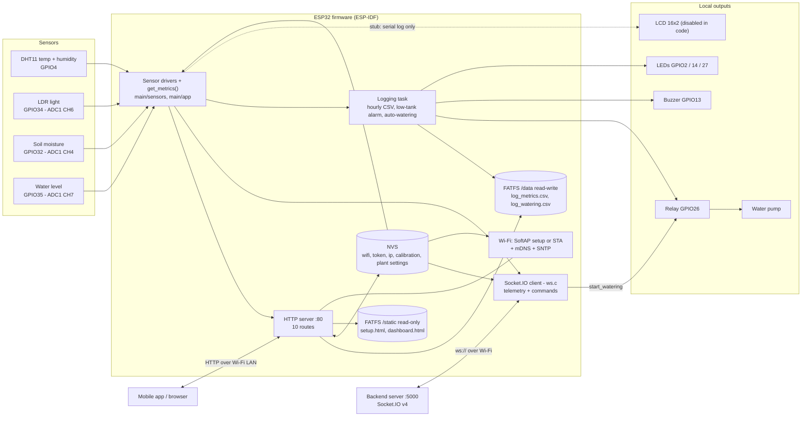
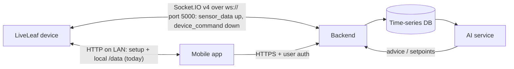
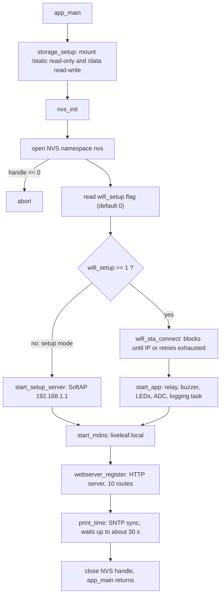
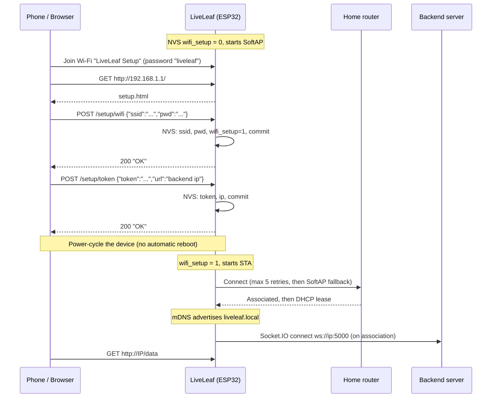
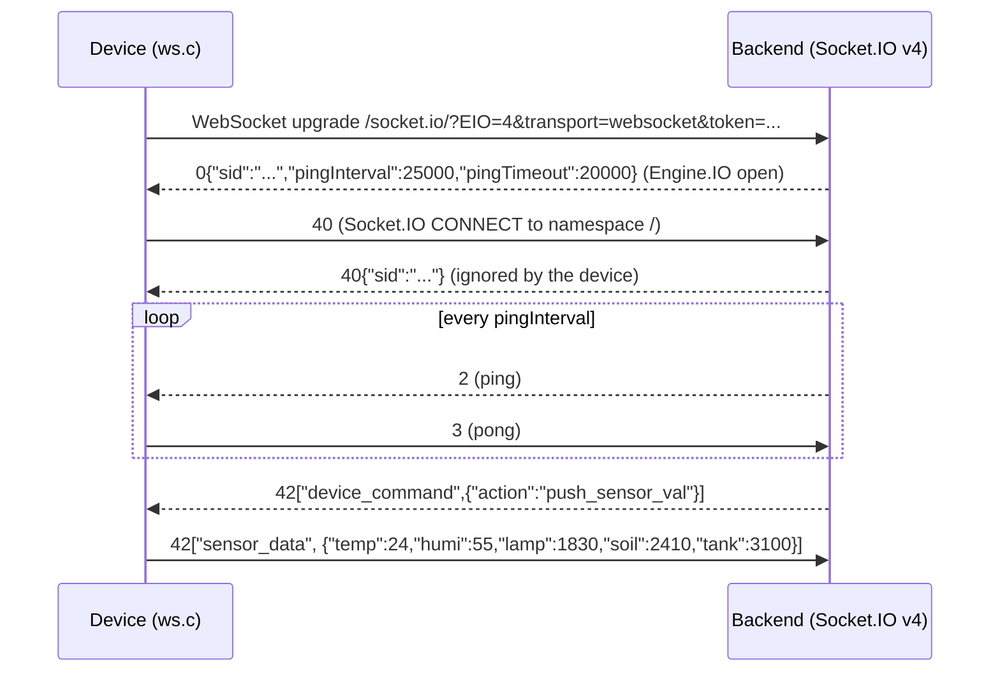

# LiveLeaf: Automatic Irrigation IoT Device

Firmware for **LiveLeaf**, an ESP32-based smart plant-care device. It measures air temperature, humidity, ambient light, soil moisture and water-tank level, waters the plant through a relay-driven pump (an hourly automatic rule, or on command), and logs readings and watering events to CSV files in flash. It exposes an HTTP/JSON API on the local network and keeps a **Socket.IO (WebSocket) connection to a backend server** for remote reads and commands, so that the mobile app, backend and AI services can build on top of it.

> **Project stage: prototype / showcase, not production.** Several parts are under construction. For example, the LCD is disabled in the code, the saved plant thresholds are not used yet, and the HTTP pump route is mis-wired. The pump, relay polarity and tank direction **must be verified on real hardware** before trusting them ([§16](#16-known-issues-and-technical-debt)).
>
> **How to read this document.** It describes what the code in the latest snapshot does **today** (see [§18](#18-revision-history) for what changed). Everything else is marked:
> ✅ implemented · 🟡 present but not wired · 🚧 under construction (planned, not in the code yet) · ➖ out of scope for the prototype · 💡 proposal (needs team agreement)

---

## Table of contents

1. [Status at a glance](#1-status-at-a-glance)
2. [System architecture](#2-system-architecture)
3. [Hardware and pin map](#3-hardware-and-pin-map)
4. [Repository layout and tech stack](#4-repository-layout-and-tech-stack)
5. [Device pipeline: boot to steady state](#5-device-pipeline-boot-to-steady-state)
6. [Wi-Fi provisioning and network modes](#6-wi-fi-provisioning-and-network-modes)
7. [Sensor data pipeline](#7-sensor-data-pipeline)
8. [HTTP API reference](#8-http-api-reference)
9. [Firmware controllers and drivers reference](#9-firmware-controllers-and-drivers-reference)
10. [Extending the firmware](#10-extending-the-firmware)
11. [Integration guide: Mobile client](#11-integration-guide-mobile-client)
12. [Integration guide: Backend](#12-integration-guide-backend)
13. [Integration guide: AI engineering](#13-integration-guide-ai-engineering)
14. [Build, flash and debug](#14-build-flash-and-debug)
15. [Troubleshooting and LCD reference](#15-troubleshooting-and-lcd-reference)
16. [Known issues and technical debt](#16-known-issues-and-technical-debt)
17. [Proposed roadmap and API additions](#17-proposed-roadmap-and-api-additions)
18. [Revision history](#18-revision-history)

**Where should I start?**

| You are... | Read first |
|---|---|
| Mobile developer | [§6](#6-wi-fi-provisioning-and-network-modes), [§8](#8-http-api-reference), [§11](#11-integration-guide-mobile-client) |
| Backend developer | [§2](#2-system-architecture), [§8](#8-http-api-reference), [§12](#12-integration-guide-backend) |
| AI engineer | [§7](#7-sensor-data-pipeline), [§13](#13-integration-guide-ai-engineering) |
| Firmware developer | [§4](#4-repository-layout-and-tech-stack), [§5](#5-device-pipeline-boot-to-steady-state), [§9](#9-firmware-controllers-and-drivers-reference), [§14](#14-build-flash-and-debug) |

---

## 1. Status at a glance

| Capability | Status | Notes |
|---|---|---|
| Read temperature and humidity (DHT11) | ✅ | On demand, `dht11_read()` |
| Read light, soil moisture, tank level (ADC1) | ✅ | Raw 12-bit values. `GET /data` now returns soil and tank as **calibrated percentages** ([§7](#7-sensor-data-pipeline)) |
| Soil and tank calibration | ✅ | `GET /calibrate/soil` and `GET /calibrate/tank` store the current raw reading in NVS ([§8.7](#87-calibration-endpoints)) |
| 16x2 LCD status UI | 🟡 | **Disabled in the code.** The `hd44780` dependency is removed and every LCD function is a stub that logs to the serial port (tag `NO-LCD`) |
| Buzzer | ✅ | 2 startup beeps and a 2-beep low-tank alarm |
| First-time Wi-Fi setup via SoftAP and web page | ✅ | SSID `LiveLeaf Setup`. In setup mode the sensors, relay and calibration are **not initialised** ([§5.1](#51-boot-sequence-mainmainc)) |
| Station (STA) mode with credentials from NVS | ✅ | Up to 5 retries, then falls back to the SoftAP (**not verified on hardware**, see [§6.3](#63-sta-connection-behavior)) |
| mDNS | ✅ | `liveleaf.local`, service `_http._tcp` on port 80 |
| Time (SNTP) | ✅ | `pool.ntp.org`, hard-coded Cairo time zone. Used for CSV timestamps only |
| Web dashboard (`GET /`) | ✅ | Served from FATFS, polls `/data` every 3 s. Contains the Wi-Fi, token and calibration forms |
| `GET /data` | ✅ | JSON, CORS `*`. **`soil` and `tank` are now percentages, not raw** |
| `POST /setup/wifi`, `POST /setup/token` | ✅ | Need a reboot to apply; see [known issues](#16-known-issues-and-technical-debt) |
| Server link: Socket.IO v4 over WebSocket (`ws.c`) | ✅ | `ws://<ip>:5000`. Commands: `push_sensor_val`, `push_sensor_log`, `push_watering_log`, `start_watering`, `save_plant_data` ([§8.6](#86-socketio-server-link-websocket)) |
| Telemetry push to the server | 🟡 | Only **on request** (`push_sensor_val`). No periodic push. `soil` and `tank` are **raw** here |
| CSV logging to flash | ✅ | Hourly metrics and every watering run, in `/data` ([§7.4](#74-csv-logging-to-flash)). Read with `GET /logs/metrics` and `GET /logs/watering` |
| Log upload over the server link | 🟡 | Sends raw binary frames. A stock Socket.IO server drops them ([§8.6](#86-socketio-server-link-websocket)) |
| Pump relay driver | ✅ | GPIO26, push-pull, **active-high in the code** (check your relay module) |
| Automatic irrigation | 🟡 | A hard-coded hourly rule inside the logging function ([§7.5](#75-automatic-irrigation-and-alarm-rule)) |
| Remote pump control over the server link | 🟡 | `start_watering` works but has no limits and no acknowledgement |
| HTTP pump route (`GET /action/watering`) | 🟡 | **Mis-wired**: returns the HTML page and does not water |
| Plant settings (`POST /action/plant/info/pull`, WS `save_plant_data`) | 🟡 | Stored in NVS, never used. The WebSocket version has a double-free bug |
| Authentication / TLS on the local API | ➖ | Plain HTTP, open access (acceptable for the prototype) |
| OTA updates | ➖ | The partition table now has a single 2 MB `factory` app and no OTA slots |
| Device ID and firmware version in messages | 🚧 | The token is the only identity |
---

## 2. System architecture

### 2.1 What exists today (firmware)



Key architectural facts for other teams:

- The device is **both** a local HTTP server (clients on the same Wi-Fi network) **and** a Socket.IO client that connects out to the backend. Over that link the server asks for data and commands, and the device answers. Nothing is pushed on a timer.
- Sensors are read **on demand** (each `GET /data` and each `push_sensor_val` triggers fresh reads) and **once an hour** by the logging task, which writes a timestamped CSV row to flash.
- The logging task also runs the **automatic irrigation rule** and the low-tank alarm ([§7.5](#75-automatic-irrigation-and-alarm-rule)).
- State that survives a reboot lives in NVS (Wi-Fi credentials, setup flag, backend `token` and `ip`, soil and tank calibration, plant settings) and in the CSV files on the `/data` partition.

### 2.2 End-to-end picture (prototype)

The device keeps a **Socket.IO (WebSocket) connection to the backend server**:

- The **token** and the **backend IP** are given to the device through `POST /setup/token` and stored in NVS. The connection is opened after Wi-Fi associates ([§8.6](#86-socketio-server-link-websocket)).
- The **server pulls** by sending `device_command` events (`push_sensor_val`, `start_watering`, ...) and the **device pushes** the answer, for example a `sensor_data` event. Snapshot 2 called these commands "interrupts" in its log text. They are server-initiated commands, not hardware GPIO interrupts.
- The mobile app provisions the device over the local HTTP API and shows data coming from the backend. How the app talks to the backend is outside this firmware repository.

The full message protocol is in [§8.6](#86-socketio-server-link-websocket). The server can start the pump, request the CSV logs and push plant settings. Telemetry is still sent only when requested.



See [§12](#12-integration-guide-backend) for what the backend side needs to prepare.

---

## 3. Hardware and pin map

Target chip: **ESP32** (`IDF_TARGET=esp32`). The repo's VS Code config references the `esp32-wrover-kit-3.3v` OpenOCD profile, but the exact dev-board model is not recorded in the repo.

| Function | Part | GPIO | Details |
|---|---|---|---|
| Temperature + humidity | DHT11 | **4** | Single-wire; needs a pull-up on the data line (most DHT11 breakout boards include it) |
| Light level | LDR in a voltage divider | **34** | ADC1 channel 6, input-only pin |
| Water tank level | Analog water-level sensor | **35** | ADC1 channel 7, input-only pin |
| Soil moisture | Analog soil sensor | **32** | ADC1 channel 4 |
| Pump relay | Relay module | **26** | **Push-pull output, active-high in the code**: `1` = pump ON, `0` = OFF (`RELAY_ON 1`, `RELAY_OFF 0`). A source comment still says "active low" ([§16](#16-known-issues-and-technical-debt)) |
| Buzzer | Buzzer driven by a plain GPIO level | **13** | `1` = sounding (use an *active* buzzer). Startup: 2 beeps. Alarm: 1 s on, 1 s off, 1 s on |
| Red LED | LED | **14** | On while the pump runs (toggled by `start_watering()`) |
| Yellow LED | LED | **27** | Low-tank alert: on when raw tank < 1228, evaluated once an hour |
| Onboard LED | LED | **2** | Configured as output, never driven |
| LCD 16x2 (HD44780), 4-bit mode | HD44780-compatible | **19, 18, 17, 16, 23, 22** (free now) | **Disabled in the code.** These were the six GPIOs passed to `lcd_bus_gpio4_create(...)`; that call is now commented out in `devices/lcd.c`. To re-enable the LCD, restore the `jef-sure/hd44780` dependency (`idf_component.yml`, `CMakeLists.txt`) and uncomment the code. Check the component header for the RS / E / D4-D7 mapping before wiring |

**Analog front end**

- All analog sensors use **ADC1** (safe to use while Wi-Fi is active, unlike ADC2).
- Channels are configured with `ADC_ATTEN_DB_12` and the default bit width (12-bit). Raw values run from **0 to 4095** and usable input is up to roughly 3.1 V.
- No ADC calibration (`esp_adc_cali`) is applied. Values are uncalibrated and slightly non-linear.

**Relay wiring note.** `relay_init()` now drives GPIO26 as a normal push-pull output and **presets it to 0 before enabling the output**. In the code `0` = OFF and `1` = ON (active-high), but the comment next to the constants still says "active low". Most cheap relay modules are **active-low** (input low = relay ON). With such a module the pump would run from boot and stop only while the pin is high. **Check the polarity of your relay module on the bench, without the pump connected, before first use.**

**Pin-conflict warnings to check on your board**

- On **WROVER modules with PSRAM**, GPIO16 and GPIO17 are used internally by the PSRAM and are not available for the LCD.
- GPIO13 and GPIO14 are **JTAG** pins (MTCK, MTMS). Using JTAG debugging conflicts with the buzzer and red LED.

---

## 4. Repository layout and tech stack

```
liveleaf/
├── CMakeLists.txt              # ESP-IDF project (project name: liveleaf)
├── partitions.csv              # Custom partition table (4 MB flash layout)
├── dependencies.lock           # Pinned managed components (IDF 6.1.0, target esp32)
├── .devcontainer/              # Docker dev container (espressif/idf image)
├── .vscode/                    # Editor config (machine-specific paths, see §16)
└── main/
    ├── main.c                  # app_main(): boot sequence
    ├── CMakeLists.txt          # Sources, REQUIRES, FATFS image creation
    ├── idf_component.yml       # Managed dependencies
    ├── app/main_app.[ch]       # start_app(), logging task, auto-watering rule, Metrics_t
    ├── sensors/                # adc.c, dht11.c, ldr.c, soil_sensor.c, water_level.c
    ├── devices/                # lcd.c (stubbed), buzzer.c, led.c, water_pump.c
    ├── fs/                     # fatfs_driver.c (read-only /static + read-write /data), nvs_driver.c
    ├── wifi/                   # driver.c (netif/events/DHCP), ap.c (SoftAP), sta.c (station + mDNS),
    │                           # ntp.c (SNTP and time zone)
    ├── webserver/              # app.c (server + helpers), controller.c (handlers),
    │                           # routes.h (URI table), controler.h (handler decls),
    │                           # ws.c (Socket.IO / WebSocket client to the backend)
    └── storage/                # setup.html, dashboard.html -> flashed to FATFS
```

> The handler header is spelled `controler.h` (one `l`). Keep that spelling when including it.

**Tech stack**

| Item | Value |
|---|---|
| Language / framework | C, ESP-IDF **6.1.0** (pinned in `dependencies.lock`), FreeRTOS |
| Build | CMake ≥ 3.22, `idf.py` |
| Target / flash | `esp32`, **4 MB** flash layout |
| Managed components | `espressif/cjson` 1.7.19~2, `esp-idf-lib/dht` 1.2.0, `espressif/esp_websocket_client` 1.8.0, `espressif/mdns` 1.14.0. (`jef-sure/hd44780` is commented out) |
| Declared but unused | `espp/dns_server` 1.3.10 (captive portal not wired), `vgerwen/lcd1602` 1.1.0 |
| IDF version | The manifest says `>=4.1.0`, but the project is pinned and built with **6.1.0**. Use 6.1 |

**Flash partition table** (`partitions.csv`)

| Name | Type / subtype | Offset | Size | Purpose |
|---|---|---|---|---|
| `nvs` | data / nvs | 0xA000 | 12 KB | Wi-Fi credentials, setup flag, backend token and IP |
| `otadata` | data / ota | 0xD000 | 8 KB | OTA state (unused: there are no OTA app slots now) |
| `phy_init` | data / phy | 0xF000 | 4 KB | RF calibration data |
| `factory` | app / factory | 0x10000 | 2 MB | The firmware (single app slot; `ota_0` and `ota_1` were replaced) |
| `data_r` | data / fat | 0x210000 | 128 KB | **`/static`**: read-only FATFS with the HTML pages |
| `data_rw` | data / fat | 0x230000 | 0x1D0000 (about 1.8 MB) | **`/data`**: read-write FATFS with wear levelling for the CSV logs. Formatted automatically on the first mount |

The table still ends exactly at 4 MB, so the board needs **4 MB or more** of flash. The `ota_1` line is commented out in `partitions.csv`.

---

## 5. Device pipeline: boot to steady state

### 5.1 Boot sequence (`main/main.c`)



Notes:

- **`start_app()` runs only in the STA branch**, after `wifi_sta_connect()` (even if the connection failed). In a **setup-mode boot** it is never called, so the **ADC, relay, LEDs, buzzer and the logging task are not initialised**. In that mode `GET /data` returns `-1` for lamp, soil and tank, the calibration routes return `500`, and watering does nothing. Provision Wi-Fi, reboot, then use the sensors. (After a STA failure, the SoftAP fallback happens *and* `start_app()` still runs.)
- `storage_setup()` mounts `/static` (read-only) and `/data` (read-write, `format_if_mount_failed = true`). Both use `ESP_ERROR_CHECK` in `main.c`, so a missing partition causes an **abort and reboot loop**.
- `wifi_sta_connect()` **blocks `app_main`**. The HTTP server is not started until the connection attempt finishes (success or 5 failed retries).
- `start_mdns()` uses `ESP_ERROR_CHECK`, so an mDNS failure aborts the boot. It runs in both modes (not verified in SoftAP mode).
- `print_time()` runs **after** the HTTP server starts and blocks `app_main` for up to about 30 s (15 tries of 2 s) when there is no internet. It then sets the Cairo time zone ([§7.4](#74-csv-logging-to-flash)).
- The server link starts from the Wi-Fi event handler: on `WIFI_EVENT_STA_CONNECTED` it calls `app_websocket_start()`, which reads `ip` and `token` from NVS and opens the Socket.IO connection (skipped silently if `ip` is missing).
- `app_main` returns at the end. Everything afterwards runs in FreeRTOS tasks.

### 5.2 Runtime tasks

| Task | Created by | Priority | Stack | Responsibility |
|---|---|---|---|---|
| `Sensor Thread Read` (`statues_updater`) | `start_app()` (STA boot only) | 3 | 2048 B | Waits 5 s, prints the 5 metrics once to the serial log, waits 5 s, then loops forever: `write_metrics_logs()` and sleep for **1 hour** |
| `httpd` | `httpd_start()` | ESP-IDF default | default | Serves HTTP on port 80 (up to 10 URI handlers) |
| WebSocket client task | `esp_websocket_client_start()` | library default | library default | Runs the Socket.IO connection. `device_command` events, including `start_watering`, run in its event callback, **not** in the HTTP task |
| Wi-Fi / lwIP / SNTP / mDNS / event loop | ESP-IDF | n/a | n/a | Network stack |

> ⚠️ The logging task now does file I/O (`fopen`, `fprintf`, FATFS), `strftime`, a 3 s alarm and the pump run. A **2048-byte stack is very likely too small** for that. If the device resets about 10 s after boot or at the hourly tick, raise the stack in `start_app()` (4096 or more).

The per-sensor `*_start_thread()` functions are **no-op stubs**. There is no other background sampling.

### 5.3 Startup indications

The LCD is disabled, so everything is on the serial log (`idf.py monitor`):

1. `NO-LCD` lines from the LCD stubs: `Starting`, `webserver start`, `LED Config`, `sensors init`, `Ready!`.
2. Two beeps from the buzzer (about 1.5 s, blocking), played in `start_app()`.
3. About 5 s after `Ready!`: one line per metric (`TEMP 24.0C K`, `HUMI ...`, `LAMP ...`, `SOIL ...`, `TANK ...`, tag `NO-LCD`). A trailing `K` means "OK", `!` means out of range or a read error.
4. About 5 s later: the first CSV row (`Log saved!`, tag `MAIN APP`). After that, one row per hour.

---

## 6. Wi-Fi provisioning and network modes

The device has two modes, selected once at boot by the NVS flag `wifi_setup`.

| | **Setup mode** (SoftAP) | **Normal mode** (Station) |
|---|---|---|
| When | `wifi_setup` missing or 0, **or** after 5 failed STA retries (fallback) | `wifi_setup == 1` |
| Network | Device creates AP `LiveLeaf Setup` | Device joins your router |
| Credentials | SSID `LiveLeaf Setup`, password `liveleaf` | From NVS (`ssid`, `pwd`) |
| Security | WPA2-PSK, PMF **required** | Accepts WPA/WPA2 or stronger. **Open networks are not supported** |
| Address | `192.168.1.1/24` (device runs DHCP) | IP from router DHCP. Find it with mDNS (`liveleaf.local`) or the router's client list |
| AP limits | Channel 1, max **2** clients | n/a |
| `GET /` returns | `setup.html` | `dashboard.html` |
| Band | 2.4 GHz only (ESP32) | 2.4 GHz only |

### 6.1 Provisioning flow



Important behaviors:

- **There is no captive portal.** The user must open `http://192.168.1.1/` manually. (`espp/dns_server` is a dependency and a DHCP option-114 snippet exists, but both are commented out or unused.)
- **There is no automatic reboot** after saving credentials. The client must tell the user to power-cycle or reset the board.
- `setup.html` and `dashboard.html` carry four forms: **Wi-Fi**, **WebServer and Remote Settings** (token + backend IP, [§8.5](#85-post-setuptoken)), **Soil Moisture Calibration** and **Tank Water Level Calibration**. A provisioned device can therefore be re-configured from the LAN. The server link only starts when Wi-Fi associates, so **reboot after saving the token too**. The two calibration buttons in the web pages are broken ([§16](#16-known-issues-and-technical-debt)); call the routes directly.
- **In a setup-mode boot the sensors are off** ([§5.1](#51-boot-sequence-mainmainc)). Calibrate only after the device has rebooted into STA mode.
- **Credentials are not validated.** `wifi_setup=1` is written as soon as the strings are saved.
- **Fallback to AP mode (new).** After the 5 failed STA retries the event handler calls `wifi_ap_setup()`, which switches the radio to the SoftAP so the user can submit new credentials. `wifi_setup` stays `1`, so after a reboot the device tries STA first again. ⚠️ **Not verified on hardware**: it re-runs `esp_wifi_init()` inside the Wi-Fi event handler ([§16](#16-known-issues-and-technical-debt)). If it does not work, erase NVS ([§14.5](#145-factory-reset--re-provisioning)).
- After joining the router the device advertises itself with **mDNS** as `liveleaf.local` (service `_http._tcp`, port 80, [§11.2](#112-finding-the-device)). The LCD no longer shows the IP because it is disabled in the code.

### 6.2 NVS data model

Namespace: `"nvs"`.

| Key | Type | Meaning |
|---|---|---|
| `wifi_setup` | int32 | `1` = credentials stored, boot in STA mode. Missing or `0` = setup mode |
| `ssid` | string | Wi-Fi network name |
| `pwd` | string | Wi-Fi password (**stored in plaintext**) |
| `token` | string | Backend auth token (**plaintext**), written by `POST /setup/token` |
| `ip` | string | Backend host/IP, written by `POST /setup/token` from the JSON field `url` |
| `soil` | int32 | Raw ADC reading saved by `GET /calibrate/soil` (the "wet" reference). Default 2048 when missing |
| `tank` | int32 | Raw ADC reading saved by `GET /calibrate/tank` (the "full" reference). Default 1930 when missing |
| `h_soil`, `l_soil`, `h_temp`, `l_temp`, `h_humi`, `l_humi`, `interval` | int32 | Plant settings saved by `POST /action/plant/info/pull` or the WS `save_plant_data` command. **Stored but never read** by the firmware |

### 6.3 STA connection behavior

- Scan method: all channels; minimum auth threshold `WPA_WPA2_PSK`.
- On `STA_DISCONNECTED` the event handler retries up to **5** times, then sets a fail bit and **calls `wifi_ap_setup()`** (SoftAP fallback).
- On `STA_CONNECTED` (Wi-Fi association, **before** DHCP gives an IP) it calls `app_websocket_start()`.
- On `GOT_IP` the retry counter resets. The **same handler also covers later disconnects**: if the router drops the device, it gets 5 fresh retries and then, with the new fallback, **switches to the SoftAP until the next reboot**. A short router outage can therefore leave a provisioned device in setup mode (SoftAP `LiveLeaf Setup`, `192.168.1.1`) and unreachable on the LAN. There is no timer that retries STA again.

---

## 7. Sensor data pipeline

```
Sensor -> GPIO/ADC1 -> raw value (0-4095, or DHT11 float) -> -1 on error
   -> get_metrics(): adds soil and tank percentages (calibration read from NVS)
   -> (a) GET /data               soil, tank = percent; lamp = raw
   -> (b) Socket.IO sensor_data   soil, tank, lamp = raw
   -> (c) hourly CSV row          soil, tank = percent (fixed formulas); lamp = raw
   -> (d) hourly rules            raw thresholds: low-tank alarm and auto-watering
```

### 7.1 Signals

| Signal | Sensor | `GET /data` | Socket.IO `sensor_data` | Error value |
|---|---|---|---|---|
| `temp` | DHT11 | float, °C | same | `-1` |
| `humi` | DHT11 | float, %RH | same | `-1` |
| `lamp` | LDR | int, raw ADC | same | `-1` |
| `soil` | Soil moisture | **float, percent 0-100** | **int, raw ADC** | `-1` |
| `tank` | Water level | **float, percent 0-100** | **int, raw ADC** | `-1` |

- `temp` and `humi` fail **together**: one DHT11 failure sets both to `-1`.
- DHT11 spec: 0-50 °C (about ±2 °C) and 20-90 %RH (about ±5 %RH), 1 unit resolution. It can only be sampled about once per second.
- Each `GET /data` and each `push_sensor_val` performs **fresh blocking reads** (no cache). `get_metrics()` also reads the calibration from NVS on every call.
- **The two interfaces disagree on `soil` and `tank`** (percent over HTTP, raw over the server link). Snapshot 2 returned raw over both.

### 7.2 Calibration and the percent formula

For `soil` and `tank`, `get_metrics()` computes:

```
percent = clamp( (4095 - raw) * 100 / (4095 - ref), 0, 100 )
```

| Signal | `ref` (NVS key) | Default | How to set it |
|---|---|---|---|
| soil | `soil`, the **wet** reference (100 %) | 2048 | Put the sensor in water, then `GET /calibrate/soil` |
| tank | `tank`, the **full** reference (100 %) | 1930 | Fill the tank, then `GET /calibrate/tank` |

- The other end is **fixed at raw 4095 = 0 %** and is not calibrated. A sensor that reads, say, 3600 when completely dry will never show 0 %.
- A higher raw value always means a **lower** percent in this formula.
- If `ref >= 4095` the result is `-1` (bad calibration).
- Calibration needs the ADC, so it only works after a **STA boot** ([§5.1](#51-boot-sequence-mainmainc)).

### 7.3 The same reading, different meanings

| Output | `soil` | `tank` | `lamp` |
|---|---|---|---|
| `GET /data` | `(4095 - raw) / (4095 - soil_wet) * 100` | `(4095 - raw) / (4095 - tank_full) * 100` | raw |
| Socket.IO `sensor_data` | raw | raw | raw |
| CSV `log_metrics.csv` | `100 - raw / 4095 * 100` (not calibrated) | `raw / 4095 * 100` (not calibrated, **not inverted**) | raw |
| Hourly rules ([§7.5](#75-automatic-irrigation-and-alarm-rule)) | raw `>= 3000` means dry: water | raw `> 1228` means water present, raw `< 1228` means alarm | n/a |
| Serial "OK" flag (`NO-LCD` lines) | `K` when raw `< 2048` | `K` when raw `> 2048` | `K` when raw `< 2048` |
| Web dashboard | shows `/data` `soil` as received | shows `/data` `tank` as received | estimates PPFD from raw (assumed 10 kΩ divider and constants; **a rough estimate**) |

What this means:

- **Soil** is consistent in direction everywhere (higher raw = drier), but the same raw reading gives different percentages. At raw 3000: `/data` shows 53.5 % with the default calibration, the CSV shows 26.7 %.
- **Tank direction is contradictory.** `GET /data` says a higher raw reading means *emptier* (0 % at raw 4095). The alarm, the auto-watering interlock, the CSV and the serial flag all say a higher raw reading means *fuller*. They cannot both be right. **Bench-test it**: record the raw `tank` value (from the Socket.IO `sensor_data`) with an empty and a full tank, then fix the formula or the thresholds.
- `lamp` is raw everywhere except the dashboard estimate. The LDR direction depends on your divider wiring. The dashboard assumes the LDR sits on the supply side of a 10 kΩ resistor (higher raw = brighter).
- **Consumers:** use the **raw** values (Socket.IO) plus your own calibration, or calibrate the device and use `/data`, but do not mix the two without converting.

### 7.4 CSV logging to flash

The logging task appends one row per hour to `/data/log_metrics.csv`, and every pump run appends a row to `/data/log_watering.csv`. Read them with `GET /logs/metrics` and `GET /logs/watering` ([§8.8](#88-csv-log-endpoints)) or the Socket.IO log commands ([§8.6](#86-socketio-server-link-websocket)).

`log_metrics.csv`

```
time,soil moisture(%),temperature(C),humidity(%),lamp(LDR Raw 0-4095),tank(%)
2026-11-09 18:00:12,26.739927,24.000000,55.000000,1830,52.014652
```

`log_watering.csv`

```
time,delay(Seconds),amount(L)
2026-11-09 18:00:15,3.000000,1.800000
```

Things to know before using this data:

- **Timestamps are local Cairo time with no offset** (`YYYY-MM-DD HH:MM:SS`). The time zone is hard-coded as `EET-2EEST,M4.5.5/0,M10.5.4/24` in `wifi/ntp.c`, so times are ambiguous when the clocks change. The clock comes from SNTP (`pool.ntp.org`). **Without internet the clock stays at 1970**, and rows are stamped `1970-01-01 ...`.
- The first row is written about 10 s after the logging task starts, which can be **before** SNTP has finished. Check for 1970 timestamps.
- `soil(%)` and `tank(%)` use the fixed, uncalibrated formulas in [§7.3](#73-the-same-reading-different-meanings). **A failed read leaks through**: with raw `-1` the soil column shows `100.024420` and the tank column `-0.024420`. `temperature` and `humidity` show `-1.000000`.
- `amount(L)` is **not measured**. It is `0.6 * seconds`, a hard-coded flow-rate guess.
- Numbers are written with `%f` (6 decimals).
- The files live on the 1.8 MB `data_rw` partition and grow forever. There is **no rotation and no delete route**. At one row per hour that is well over a year.
- If a file cannot be opened the row is skipped, **and so is the irrigation rule** ([§7.5](#75-automatic-irrigation-and-alarm-rule)).

### 7.5 Automatic irrigation and alarm rule

The rule lives at the end of `write_metrics_logs()` in `app/main_app.c` and runs **once per hour** (first run about 10 s after the logging task starts). It uses raw ADC values and hard-coded thresholds.

| Condition (raw ADC) | Action |
|---|---|
| `tank < 1228` | Yellow LED on, `play_alarm()` (about 3 s, blocking) |
| `tank >= 1228` | Yellow LED off |
| `soil >= 3000` **and** `tank > 1228` | `start_watering(NULL)`: red LED on, relay on for **3 s**, relay off, row in `log_watering.csv` |

Caveats:

- The thresholds (3000, 1228) and the 3 s duration are constants. The plant settings saved through `/action/plant/info/pull` or `save_plant_data` are **not used** ([§8.10](#810-plant-settings)).
- At most one run per hour, and no other cooldown.
- A read error is `-1`: `tank = -1` counts as `< 1228` and **triggers the alarm**; `soil = -1` never waters.
- The rule assumes a higher tank raw value means more water, which contradicts `GET /data` ([§7.3](#73-the-same-reading-different-meanings)).
- It runs in the logging task, so the alarm and the pump run inside a task with a 2 KB stack.
- Manual watering (`start_watering` over the server link) has **no tank check** and no limits.

This rule is the on-device baseline that any AI recommendation should be compared against ([§13.4](#134-how-ai-should-and-should-not-control-the-pump-)).

---

## 8. HTTP API reference

### 8.1 Conventions

| | |
|---|---|
| Base URL | `http://<device-ip>/`. In setup mode the IP is `192.168.1.1` |
| Transport | **Plain HTTP on port 80.** No TLS |
| Auth | **None** (prototype). Any client on the same network can call every endpoint |
| Format | JSON (`application/json`) for data. Errors are plain text |
| Error bodies | ESP-IDF style: HTTP status + short text message |
| Versioning | None |
| CORS | Only `GET /data` sends `Access-Control-Allow-Origin: *`. There is **no `OPTIONS` handler** |
| Concurrency | Default ESP-IDF HTTP server config: a small number of simultaneous sockets (about 7). Reuse/close connections politely |
| Always available | All 10 routes are registered in **both** modes. The sensor, calibration and pump routes need `start_app()` and only work after a **STA boot** |

**Routes at a glance**

| Method | Path | Purpose | Section |
|---|---|---|---|
| GET | `/` | HTML UI (`dashboard.html` or `setup.html`) | [§8.2](#82-get-) |
| GET | `/data` | Sensor snapshot (JSON) | [§8.3](#83-get-data) |
| POST | `/setup/wifi` | Save Wi-Fi credentials | [§8.4](#84-post-setupwifi) |
| POST | `/setup/token` | Save backend token and IP | [§8.5](#85-post-setuptoken) |
| GET | `/calibrate/soil`, `/calibrate/tank` | Save the current raw reading as the soil-wet / tank-full reference | [§8.7](#87-calibration-endpoints) |
| GET | `/logs/metrics`, `/logs/watering` | Download the CSV logs | [§8.8](#88-csv-log-endpoints) |
| GET | `/action/watering` | **Mis-wired**: returns the HTML page | [§8.9](#89-watering-over-http-mis-wired) |
| POST | `/action/plant/info/pull` | Save plant thresholds (stored, unused) | [§8.10](#810-plant-settings) |

The server is configured for **10 URI handlers, and all 10 are used**. Raise `max_uri_handlers` before adding a route ([§10.1](#101-add-a-new-http-endpoint)).

### 8.2 `GET /`

Returns the HTML UI. The page depends on the current Wi-Fi mode:

| Wi-Fi mode | Response |
|---|---|
| STA | `dashboard.html`, a live dashboard polling `/data` every 3 s (temperature, humidity, soil %, tank %, and a light tile that estimates PPFD from the raw `lamp` value), plus the Wi-Fi, token and calibration forms |
| anything else (AP) | `setup.html` |

- `200 text/html`, streamed in 256-byte chunks from `/static/*.html`.
- `500 Failed to open HTML file` if the file or Wi-Fi mode can't be read.

This route is for humans and browsers. **Mobile apps should use `/data`.**

### 8.3 `GET /data`

Returns one fresh snapshot of all sensors.

```bash
curl -s http://liveleaf.local/data
```

```json
{"temp":24,"humi":55,"lamp":1830,"soil":53.49291801452637,"tank":78.1}
```

| Field | Type | Unit | Range | On failure |
|---|---|---|---|---|
| `temp` | number | °C | 0-50 (DHT11 spec) | `-1` |
| `humi` | number | %RH | 20-90 (DHT11 spec) | `-1` |
| `lamp` | integer | raw ADC counts | 0-4095 | `-1` |
| `soil` | number | **percent, calibrated** ([§7.2](#72-calibration-and-the-percent-formula)) | 0-100 | `-1` |
| `tank` | number | **percent, calibrated** | 0-100 | `-1` |

> ⚠️ **Changed in snapshot 3.** `soil` and `tank` used to be raw ADC integers. They are now floats in percent. Clients written for the old format must be updated. The Socket.IO `sensor_data` event still carries raw `soil` and `tank` ([§8.6](#86-socketio-server-link-websocket)).

Response headers: `Content-Type: application/json`, `Access-Control-Allow-Origin: *`, `Cache-Control: no-store`.

Rules of thumb:

- A `-1` means "this sensor failed to read". It is **not a measurement**. Drop it or store it as `null`.
- In a **setup-mode boot** the ADC is not initialised, so `lamp`, `soil` and `tank` are `-1` ([§5.1](#51-boot-sequence-mainmainc)).
- The percent fields are floats converted from `float`, so they may print many decimals. Round on the client.
- The response always has HTTP `200` as long as the server could build the JSON. Sensor errors are reported **in-band** as `-1`. `500` is returned only if JSON allocation fails.
- **Poll no faster than every 2-3 seconds**, because of the DHT11 limit and because each call reads NVS and the sensors.
- The payload has **no timestamp, device ID or firmware version**. Whoever polls must attach them.

### 8.4 `POST /setup/wifi`

Stores Wi-Fi station credentials in NVS and marks the device as provisioned.

```bash
curl -i -X POST http://192.168.1.1/setup/wifi \
  -H 'Content-Type: application/json' \
  -d '{"ssid":"MyHomeWiFi","pwd":"supersecret123"}'
```

Request body (JSON, max **2048 bytes**):

| Field | Type | Required | **Client-side limits (firmware does not enforce them)** |
|---|---|---|---|
| `ssid` | string | yes | 1-31 bytes |
| `pwd` | string | yes | 8-63 bytes (WPA2). Open networks unsupported |

> ⚠️ **Enforce the limits in the client.** The firmware reads credentials into fixed stack buffers at boot (`char ssid[32]`, `char pwd[64]`). An oversized SSID or password stored through the API can corrupt memory on the next boot.

| Status | Body | Meaning |
|---|---|---|
| `200` | `OK` (`text/plain`) | Credentials saved. **Reboot needed** to apply |
| `400` | `Invalid size` | Empty body or body over 2048 bytes |
| `400` | `Missing SSID or password` | `ssid` or `pwd` missing or not strings |
| `500` | (generic) | Body is not valid JSON |
| `500` | `Failed to open nvs` / `Failed to allocate memory...` | Internal error |

> ⚠️ **Error-path quirk.** In `setup_wifi_handle`, the `400 Missing SSID or password` and `500 Failed to open nvs` branches `goto cleanup`, and the code after that label **also sends `200 OK`**. A client may therefore receive a second, unexpected response after the error. Until this is fixed, trust the **first status line**, and treat the call as successful only if that first response is `200`. See [§16](#16-known-issues-and-technical-debt).

Side effects: writes `ssid`, `pwd`, `wifi_setup=1` and commits. It works in **both** modes, so a client on the home LAN can also re-provision the device. There is no auth protecting this.

### 8.5 `POST /setup/token`

Stores the **backend token** and **backend IP** used by the server link ([§8.6](#86-socketio-server-link-websocket)).

```bash
curl -i -X POST http://192.168.1.50/setup/token \
  -H 'Content-Type: application/json' \
  -d '{"token":"<device token>","url":"192.168.1.10"}'
```

Request body (JSON, max **2048 bytes**):

| Field | Type | Required | Stored as (NVS key) | Notes |
|---|---|---|---|---|
| `token` | string | yes | `token` | Sent to the backend in the WebSocket URL. The setup page is written for a 256-character token |
| `url` | string | yes | `ip` | Backend **host or IP only**: no `ws://`, no port, no path. The port is fixed to **5000** in firmware |

Responses use the same shape as `POST /setup/wifi` (`200 OK`, `400 Invalid size`, `400 Missing SSID or password`, `500 ...`). Notes:

- The `400 Missing SSID or password` text is **misleading**: here it means `token` or `url` is missing or not a string.
- It has the **same error-path quirk** as `/setup/wifi`: after a `400`/`500` the handler also sends `200 OK` ([§8.4](#84-post-setupwifi)). Trust the first status line.
- It does **not** touch `wifi_setup`, and it works in both modes. Nothing restarts the server link, so the new values are used the next time Wi-Fi associates (in practice, **reboot the device**).
- There is no length validation beyond the 2048-byte body. `ws.c` builds the URL in a 512-byte buffer and truncates it silently if it is longer.
- The browser forms declare the `url` input with `minlength="256" maxlength="256"` (copy-paste of the token field), so the browser flags a normal IP address. Mobile clients are not affected.

### 8.6 Socket.IO server link (WebSocket)

Implemented in `webserver/ws.c`. The device is a **Socket.IO v4 client** (Engine.IO `EIO=4`) on the plain WebSocket transport. A generic WebSocket server will **not** work: the backend must speak Socket.IO v4 (for example `python-socketio` / Flask-SocketIO, or the `socket.io` package for Node.js).

| Item | Value |
|---|---|
| Connection URL | `ws://<ip>:5000/socket.io/?EIO=4&transport=websocket&token=<token>`, with `<ip>` and `<token>` read from NVS (set by `POST /setup/token`) |
| Scheme / port | Plain `ws://` (no TLS). Port **5000** is hard-coded |
| Auth | The token travels in the **query string**. Validate it in the Socket.IO `connect` handler |
| Namespace | Default `/`. The device sends `40` with no namespace and no auth payload |
| Started | On every `WIFI_EVENT_STA_CONNECTED`. Skipped if NVS has no `ip` |
| Reconnect | Left to the `esp_websocket_client` library defaults. The app adds no logic |
| Status on the device | Serial log tag `LIVELEAF_WS` only |

Handshake and normal operation:



**Messages**

| Direction | Event | Payload | Meaning |
|---|---|---|---|
| server -> device | `device_command` | `{"action": "<name>", ...}` | A command. See the next table |
| device -> server | `sensor_data` | `{"temp","humi","lamp","soil","tank"}` | One telemetry snapshot. Same fields as `GET /data`, **but `soil` and `tank` are raw ADC counts** |
| device -> server | (none: raw binary frames) | CSV file contents | Answer to `push_sensor_log` / `push_watering_log` |

**`device_command` actions**

| `action` | Extra fields | Status | What the device does |
|---|---|---|---|
| `push_sensor_val` | none | ✅ | Reads all sensors and emits one `sensor_data` event |
| `push_sensor_log` | none | 🟡 | Streams `/data/log_metrics.csv` as one fragmented **binary** WebSocket message (1 KB chunks, 5 s send timeout) |
| `push_watering_log` | none | 🟡 | Same, for `/data/log_watering.csv` |
| `start_watering` | `duration` (seconds, number) | 🟡 | Runs the pump for `duration` seconds **inside the WebSocket callback** (blocking). No upper limit, no tank check, no acknowledgement |
| `save_plant_data` | `data` (object, [§8.10](#810-plant-settings)) | ⚠️ | **Do not use: it crashes the device** (double free, [§16](#16-known-issues-and-technical-debt)). The values would be stored but are not used anyway |
| anything else | n/a | n/a | Ignored silently. So are events with other names |

`pump_on` and `pump_off` from snapshot 2 no longer exist. `start_watering` replaces them.

Raw frames, as they appear on the wire:

```
server -> device   42["device_command",{"action":"push_sensor_val"}]
server -> device   42["device_command",{"action":"start_watering","duration":5}]
device -> server   42["sensor_data", {"temp":24,"humi":55,"lamp":1830,"soil":2410,"tank":3100}]
```

**Behavior to design around**

- **Telemetry is on request only.** Nothing sends `sensor_data` except the `push_sensor_val` command, so the backend must emit it on a schedule (every 5 s or slower, because of the DHT11 limit). The device also logs hourly to its own CSV files.
- **No acknowledgements** (no Socket.IO ack ids): `start_watering` gives no result and nothing reports errors.
- **No device ID or timestamp** in the messages. The connection (token) is the identity. Stamp readings when they arrive.
- **A rejected token is invisible to the device.** The server answers the CONNECT with a `44{...}` packet, which the firmware ignores, and the device keeps answering pings. Detect and log rejects on the server side.
- **The CSV upload does not work with a stock Socket.IO server.** The firmware sends raw binary frames that are not Socket.IO packets. In a test with `python-socketio` 5.x the server raised `ValueError: invalid literal for int()` inside `_handle_eio_message`, dropped the frame, and kept the connection open. The data is lost. Until firmware wraps the logs in a Socket.IO event, read the logs with `GET /logs/*` on the LAN, or handle raw Engine.IO binary messages on the server.
- **`start_watering` blocks the WebSocket task for the whole run.** During that time the device cannot answer Engine.IO pings. With the default `pingInterval` of 25 s and `pingTimeout` of 20 s, a long run can make the server drop the connection. The firmware computes `(int)duration * 1000`, so fractional seconds are truncated. A message without `duration` crashes the device (NULL pointer). **The backend must validate and bound `duration`** (for example 1 to 10 s), because the device does not.
- Incoming events are parsed only when a single text frame holds a two-element array `["name", {object}]`. A disconnect is only logged.
- Plain `ws://`, token in the URL, fixed port: acceptable for the prototype, not for production.

> **How this was checked.** The handshake, ping/pong, `device_command` and `sensor_data` framing were tested against a Socket.IO v4 server (`python-socketio` 5.18) using a script that re-implements the logic of `ws.c` over a raw WebSocket. The binary-frame behavior above was tested the same way. The new commands (`start_watering`, `save_plant_data`, the log pushes) were **not** tested end to end, and nothing was tested on a real device. A reference server is in [§12.6](#126-backend-checklist-and-reference-stub).

### 8.7 Calibration endpoints

```bash
curl -i http://liveleaf.local/calibrate/soil   # sensor in water  -> stores the "wet" reference
curl -i http://liveleaf.local/calibrate/tank   # tank full        -> stores the "full" reference
```

- Each call reads the **current raw ADC value** and stores it in NVS (`soil` / `tank`). `GET /data` uses it immediately; the Socket.IO raw values and the CSV do not.
- `200 OK` (`text/plain`), or `500 calibrate again` if the ADC read fails (always the case in a setup-mode boot).
- These are **state-changing GET requests with no body and no auth**. Anyone on the LAN can recalibrate the device, and a link prefetcher could trigger them.
- The buttons in `setup.html` and `dashboard.html` do not work: their `calibrate()` function uses variables that do not exist, so the browser throws before sending ([§16](#16-known-issues-and-technical-debt)). Call the routes directly.

### 8.8 CSV log endpoints

```bash
curl -s http://liveleaf.local/logs/metrics  -o log_metrics.csv
curl -s http://liveleaf.local/logs/watering -o log_watering.csv
```

- `200 text/csv`, streamed in 256-byte chunks from `/data/log_*.csv`. Column formats and caveats are in [§7.4](#74-csv-logging-to-flash).
- `500 Failed to open HTML file` (a copy-pasted message) when the file does not exist yet, for example before the first hourly row or in a setup-mode boot.
- No CORS headers, no filtering by time, and no way to clear or rotate the files.

### 8.9 Watering over HTTP (mis-wired)

`GET /action/watering` is registered, but its handler in `routes.h` is `starting_page_handle`. It therefore returns the **HTML page** (`200 text/html`) and does **not** water. A real handler, `start_watering_handle`, exists in `controller.c` (it expects a JSON body `{"duration": <seconds>}`) but is not connected, and it has bugs ([§16](#16-known-issues-and-technical-debt)). Today the pump can only be started by the hourly rule or by the Socket.IO `start_watering` command.

### 8.10 Plant settings

```bash
curl -i -X POST http://liveleaf.local/action/plant/info/pull \
  -H 'Content-Type: application/json' \
  -d '{"h_soil":3000,"l_soil":1500,"h_temp":35,"l_temp":10,"h_humi":80,"l_humi":30,"interval":3600}'
```

| Field | Stored as (NVS key) | Notes |
|---|---|---|
| `h_soil`, `l_soil`, `h_temp`, `l_temp`, `h_humi`, `l_humi` | same name, int32 | Presumably high and low limits (an assumption: the firmware gives no meaning or units). Decimals are truncated |
| `interval` | `interval`, int32 | Presumably the logging or telemetry interval. **Not used**: the logging task always sleeps 1 hour |

- All fields are optional numbers; others are ignored. The response is `200 OK` (`text/plain`).
- It has the same **error-path fall-through** as the setup routes ([§8.4](#84-post-setupwifi)), so a failure is followed by a `200 OK` too.
- Unlike the calibration routes it never calls `commit_nvs()`.
- **Nothing reads these values.** The irrigation rule uses fixed thresholds ([§7.5](#75-automatic-irrigation-and-alarm-rule)). Treat the endpoint as a placeholder for future settings.

### 8.11 Endpoints not available yet (return 404)

| Endpoint | Status |
|---|---|
| Working HTTP pump route | 🚧 (`/action/watering` exists but is mis-wired, [§8.9](#89-watering-over-http-mis-wired)) |
| Device info / reboot / reset / config | 🚧 (see [§17](#17-proposed-roadmap-and-api-additions)) |
| Clear or rotate the CSV logs | 🚧 |

---

## 9. Firmware controllers and drivers reference

"Controller" here means two layers: **web controllers** (HTTP handlers) and **device drivers** (sensors and actuators). All functions below are in `main/`.

### 9.1 Web layer (`webserver/`)

| Function | File | Description |
|---|---|---|
| `webserver_register()` | `app.c` | Starts the HTTP server (`HTTPD_DEFAULT_CONFIG()` with `max_uri_handlers = 10`) and registers the 10 routes from `routes.h` |
| `recv_req_data(req, buf)` | `app.c` | Reads the full request body into `buf` and null-terminates it. `buf` must be at least `content_len + 1` bytes. Rejects empty bodies and bodies over `MAX_PAYLOAD_SIZE` (2048) with `400 Invalid size` |
| `send_req_data(file, req)` | `app.c` | Streams a `FILE*` to the client in 256-byte chunks and **closes the file**. The caller must finish the response with `httpd_resp_send_chunk(req, NULL, 0)` |
| `starting_page_handle` | `controller.c` | `GET /`. Chooses `dashboard.html` or `setup.html` by Wi-Fi mode. **Also (by mistake) the handler of `GET /action/watering`** |
| `setup_wifi_handle` | `controller.c` | `POST /setup/wifi`. Parses JSON with cJSON and stores values in NVS |
| `setup_cloud_credentials` | `controller.c` | `POST /setup/token`. Stores `token` and `url` in NVS as `token` and `ip`. A copy of `setup_wifi_handle`, including its error-path quirk |
| `read_endpoint_handle` | `controller.c` | `GET /data`. Calls `get_metrics()` and returns `temp`, `humi`, raw `lamp`, and `soil_percent` / `tank_percent` as `soil` / `tank` |
| `set_soil_calibration_handle`, `set_tank_calibration_handle` | `controller.c` | `GET /calibrate/soil` and `/calibrate/tank`. Read the ADC once, store the raw value in NVS (`soil` / `tank`) and commit |
| `send_metrics_logs_handle`, `send_watering_logs_handle` | `controller.c` | `GET /logs/metrics` and `/logs/watering`. Stream the CSV file as `text/csv` |
| `start_watering_handle` | `controller.c` | Parses `{"duration": seconds}` and calls `start_watering()`. **Not registered** (see above) and buggy |
| `plant_set_info_handle` | `controller.c` | `POST /action/plant/info/pull`. Stores the optional plant settings in NVS (no commit) |

The route table lives in `routes.h` as `static const httpd_uri_t` objects. It has no include guard, so **include it only from `app.c`**.

### 9.2 Sensors (`sensors/`)

| API | Behavior |
|---|---|
| `adc_manager_init()` | Creates the single ADC1 one-shot unit and configures channels 6 (LDR), 7 (tank) and 4 (soil) at 12 dB attenuation. **Must be called once before any ADC read.** Exposes `adc1_handle` |
| `ldr_read(int *out)` | Raw ADC1 CH6 (GPIO34) |
| `waterlevel_read(int *out)` | Raw ADC1 CH7 (GPIO35) |
| `soilsensor_read(int *out)` | Raw ADC1 CH4 (GPIO32) |
| `dht11_read(float *temp, float *humi)` | Reads the DHT11 on GPIO4 via `esp-idf-lib/dht` |
| `*_start_thread()` | No-ops (periodic logging disabled) |

Return value: `ESP_OK` on success, otherwise an error. `ESP_ERR_INVALID_ARG` for a NULL pointer or an uninitialized ADC handle, or the underlying driver error. Reads are blocking and one-shot.

> `ldr_init()`, `soilsensor_init()` and `waterlevel_init()` are **declared in the headers but not defined**. Do not call them (link error). Initialization is done centrally by `adc_manager_init()`.

### 9.3 Local outputs (`devices/`)

| API | Behavior |
|---|---|
| `lcd_drv_init()` | **Stub.** Returns `NULL`. `hd44780_t` is now a `typedef int` and the HD44780 code is commented out |
| `lcd_print_log(lcd, msg)` | **Stub.** Logs `msg` with tag `NO-LCD`. The old 2 s delay is gone |
| `lcd_print_value(lcd, label, value, unit, ok)` | **Stub.** Logs `"<LABEL> <value><unit> K"` (or `!`), at most 12 characters. A negative value logs `<LABEL> ERROR` |
| `lcd_print_wifi(lcd)`, `lcd_print_ip(lcd, ifkey)` | **Stubs** that do nothing |
| `init_buzzer()` / `play_startup()` | Configure GPIO13 / play 2 beeps (500 ms on, 500 ms off). **Blocking** |
| `play_alarm()` | 1 s on, 1 s off, 1 s on. **Blocking** (about 3 s) |
| `led_config()` | Configures GPIO 2, 14, 27 as outputs |
| `led_red_toggle()` | Flips the red LED (14) |
| `led_yellow_on()` / `led_yellow_off()` | Set the yellow LED (27). `led_yellow_toggle()` was removed |
| `relay_init()` | Configures GPIO26 as a **push-pull** output and presets it to OFF (`0`) |
| `start_watering(int *delay_ms)` | `NULL` means 3000 ms. Toggles the red LED, sets GPIO26 to ON (`1`), **blocks** for `delay_ms`, sets it to OFF (`0`), toggles the LED back, then calls `write_watering_log()`. There is no mutex, so two overlapping calls (for example the hourly rule and a server command) can cut each other's run short |
| `write_watering_log(int *delay_ms)` | Appends `time,seconds,litres` to `/data/log_watering.csv` (litres = `0.6 * seconds`, an assumed flow rate) |

`relay_init()` is called from `start_app()`, so the pump only works after a STA boot. See the polarity warning in [§3](#3-hardware-and-pin-map).

### 9.4 Storage (`fs/`)

| API | Behavior |
|---|---|
| `storage_setup()` | Mounts partition `data_r` **read-only** at `/static` (never formats), then partition `data_rw` **read-write with wear levelling** at `/data` (**formats it if the mount fails**). Max 4 open files per mount |
| `nvs_init()` | `nvs_flash_init()`, erasing and retrying if the partition is full or has a new version |
| `open_nvs_handle()` | Opens namespace `"nvs"` read-write. Returns `0` on failure |
| `store_nvs_int / read_nvs_int` | int32 set / get by key |
| `store_nvs_str / read_nvs_str / read_nvs_str_size` | String set / get. Query the size first, then read |
| `commit_nvs(handle)` / `close_nvs(handle)` | **Always commit after writes**, then close |

### 9.5 Wi-Fi (`wifi/`)

| API | Behavior |
|---|---|
| `wifi_setup()` | One-time init of netif, the default event loop and a logging handler |
| `wifi_ap_setup()` | Creates the SoftAP (`LiveLeaf Setup`), applies the `192.168.1.1/24` DHCP config and starts Wi-Fi |
| `dhcp_setup(netif)` | Stops DHCP, sets a static `192.168.1.1/24`, restarts DHCP |
| `start_mdns()` | In `sta.c`. `mdns_init()`, hostname `liveleaf`, instance name `LiveLeaf Demo Device`, service `_http._tcp` on port 80. Uses `ESP_ERROR_CHECK` |
| `print_time()` | In `ntp.c`. Starts SNTP with `pool.ntp.org`, waits up to 15 x 2 s, then sets the time zone `EET-2EEST,M4.5.5/0,M10.5.4/24` (Cairo) and logs the local time |
| `wifi_sta_connect(&nvs_handle)` | Reads `ssid`/`pwd` from NVS, connects, **blocks** until connected or failed. Returns `ESP_OK` even on failure. Its event handler also calls `app_websocket_start()` on `STA_CONNECTED` and `wifi_ap_setup()` after the 5th failed retry |

### 9.6 App layer (`app/`)

| API | Behavior |
|---|---|
| `start_app()` | `relay_init()`, LCD stub, buzzer and startup beeps, LEDs, `adc_manager_init()`, then creates the logging task. **Called only in a STA boot** |
| `start_setup_server()` | `wifi_setup()` + `wifi_ap_setup()` (name is misleading: it starts the **SoftAP**; the HTTP server is started separately by `webserver_register()`) |
| `get_metrics()` | Reads all sensors and the soil/tank calibration from NVS into `Metrics_t`, using `-1` for any failed read. Used by `/data`, `push_sensor_data()` and the logging task |
| `statues_updater` (task) | Waits 5 s, logs the 5 metrics once, waits 5 s, then loops: `write_metrics_logs()` and sleep 1 hour |
| `write_metrics_logs()` | Appends the CSV row, then runs the alarm and auto-watering rule ([§7.5](#75-automatic-irrigation-and-alarm-rule)). Not declared in the header |
| `get_current_time(buf)` | Formats the local time as `%Y-%m-%d %H:%M:%S` into `buf` (at least 20 bytes). Declared in `main_app.h` |
| `Metrics_t` | `{ int tank; float tank_percent; int soil; float soil_percent; int ldr; float temp; float humidity; }` |

`Metrics_t` is shared by the logging task, `/data` and `ws.c`. Reuse it for any new consumer.

### 9.7 Server link (`webserver/ws.c`)

| API | Behavior |
|---|---|
| `app_websocket_start()` | Reads `ip` and `token` from NVS, builds `ws://<ip>:5000/socket.io/?EIO=4&transport=websocket&token=<token>` (512-byte buffer), creates the `esp_websocket_client`, registers the event handler and starts it. Returns silently if `ip` is missing. Called from the Wi-Fi event handler on `STA_CONNECTED` |
| `push_sensor_data()` | If the client is connected, calls `get_metrics()` and sends `42["sensor_data", {...}]` (256-byte buffer) with **raw** `soil` and `tank`. Called by the `push_sensor_val` command |
| `push_file_logs_raw(path)` | Streams a file as one fragmented binary WebSocket message in 1 KB chunks (`send_bin_partial`, `send_cont_msg`, `send_fin`, 5 s timeout each). Used by `push_sensor_log` and `push_watering_log`. Returns an `esp_err_t`; the server is not told about failures |
| `handle_plant_set_info_ws(root)` | Stores the optional plant settings in NVS. **It calls `cJSON_Delete(root)` on a node it does not own**, which causes a double free ([§16](#16-known-issues-and-technical-debt)) |
| `websocket_event_handler` (static) | Engine.IO/Socket.IO state machine: replies `40` to the open packet `0...`, replies `3` to a ping `2`, and parses `42[...]` events. Handles `device_command` actions as listed in [§8.6](#86-socketio-server-link-websocket) |
| `ws_client` | Global (non-static) client handle |

The event handler runs in the WebSocket library's context. Everything it calls (sensor reads, file streaming, **the whole pump run**) blocks that context, so the connection cannot answer pings meanwhile. Keep command handlers short.

---

## 10. Extending the firmware

### 10.1 Add a new HTTP endpoint

1. Declare the handler in `webserver/controler.h`.
2. Implement it in `webserver/controller.c`. Set headers **before** `httpd_resp_send()`, and use `cJSON_PrintUnformatted` + `cJSON_free` + `cJSON_Delete` for JSON bodies.
3. Add an `httpd_uri_t` in `webserver/routes.h`.
4. Register it in `webserver_register()` in `webserver/app.c`.

`start_webserver()` sets `config.max_uri_handlers = 10`, and **all 10 slots are used**. Raise it before adding a route.

If the endpoint will be called from a browser with `Content-Type: application/json` on a different origin, you must also add an `OPTIONS` handler (preflight). Native mobile clients don't need it.

### 10.2 Fix the HTTP pump route 💡

`GET /action/watering` currently points at the page handler. To expose the pump over HTTP properly:

1. In `routes.h`, set `.handler = start_watering_handle` and change the method to `HTTP_POST` (a state-changing action should not be a GET).
2. Fix `start_watering_handle` in `controller.c` first. Its `cleanup:` label runs on every call and frees `root` twice (`cJSON_Delete` then `cJSON_free`), and when `duration` is missing it jumps there and **still calls `start_watering()` with an uninitialised value**. Return right after the `400`, and free `root` once.
3. Bound the duration (for example 1 to 10 s) and check the tank before starting.
4. `start_watering()` blocks, so run it in its own task and answer the request immediately. The same applies to the Socket.IO command.

### 10.3 Add a new analog sensor

1. Pick an **ADC1** GPIO (ADC2 conflicts with Wi-Fi).
2. Add `adc_oneshot_config_channel(...)` in `adc_manager_init()`.
3. Create `sensors/<name>.c/.h` with a `<name>_read(int *out)` modeled on `soil_sensor.c`.
4. Add the `.c` file to `main/CMakeLists.txt` (`SRCS`).
5. Add a field to `Metrics_t` and `get_metrics()`, then expose it in `read_endpoint_handle`, in `push_sensor_data()` (`ws.c`) and, if it should be logged, in `write_metrics_logs()` (CSV header and row).
6. **Document the new JSON field here and tell the mobile/backend/AI teams**, because it is an API change.

### 10.4 Change the web pages

Edit `main/storage/*.html` and rebuild and flash. `fatfs_create_rawflash_image(data_r "storage" FLASH_IN_PROJECT)` packs the folder into the `data_r` partition (128 KB total). The FATFS mount is read-only, so the pages **cannot be changed at runtime**. Note that `setup.html` and `dashboard.html` now carry copies of the same four forms and JavaScript, so change both. Runtime data such as the CSV logs lives on the separate read-write `/data` partition.

### 10.5 Add a new server command (Socket.IO)

1. In `websocket_event_handler` (`webserver/ws.c`), add another `if (strcmp(action->valuestring, "<name>") == 0)` block next to the existing ones (they are independent `if`s, not an `else if` chain). Read extra fields from `event_data_obj` and **check every field for NULL and its type** before using it (`start_watering` does not, and crashes without `duration`).
2. Keep it short and non-blocking. `start_watering` shows what *not* to do: it blocks the WebSocket task for the whole pump run. Hand long work to a task (for example with a task notification) and report back when it is done.
3. If the backend needs an answer, emit an event the same way `push_sensor_data()` does (`42["<event>", {...}]`). There are no Socket.IO acks today. Do **not** send raw binary frames unless the server is built to receive them.
4. Free cJSON objects exactly once. `handle_plant_set_info_ws()` deletes a node it does not own, which is the bug to avoid.
5. Document the action in [§8.6](#86-socketio-server-link-websocket) and tell the backend team.

---

## 11. Integration guide: Mobile client

### 11.1 Onboarding flow to implement

1. Ask the user to power on a fresh device. Its Wi-Fi network `LiveLeaf Setup` becomes visible (the LCD is disabled, so there is no on-device indication).
2. Join SoftAP `LiveLeaf Setup` / password `liveleaf` programmatically:
   - Android: `WifiNetworkSpecifier` via `ConnectivityManager.requestNetwork`.
   - iOS: `NEHotspotConfiguration`.
3. The AP has **no internet**. Bind your HTTP traffic to that network (Android: `bindProcessToNetwork` or use the network's socket factory), or the OS may route requests over cellular or drop the AP.
4. Collect the home Wi-Fi SSID and password. **Validate**: SSID 1-31 bytes, password 8-63 bytes, 2.4 GHz network, WPA/WPA2 or stronger.
5. `POST http://192.168.1.1/setup/wifi` (JSON). Proceed only if the first response is `200 OK`. See the error-path quirk in [§8.4](#84-post-setupwifi).
6. If the device must reach the backend, `POST http://192.168.1.1/setup/token` with `{"token": "...", "url": "<backend host or IP>"}` ([§8.5](#85-post-setuptoken)). `url` has no scheme or port (the port is fixed to 5000). Get the token from your backend.
7. Tell the user to **power-cycle the device** (the firmware does not reboot itself).
8. Rejoin the phone to the home Wi-Fi, then discover the device ([§11.2](#112-finding-the-device)).
9. Calibrate the sensors: soil sensor in water, then `GET /calibrate/soil`; tank full, then `GET /calibrate/tank` ([§8.7](#87-calibration-endpoints)). This only works after the reboot into STA mode.

If the credentials were wrong, the device should fall back to the SoftAP after its retries (the `LiveLeaf Setup` network reappears; this fallback is not verified on hardware). Repeat from step 2.

### 11.2 Finding the device

After it joins Wi-Fi, the device advertises itself with **mDNS**:

| mDNS item | Value |
|---|---|
| Hostname | `liveleaf.local` |
| Instance name | `LiveLeaf Demo Device` |
| Service | `_http._tcp`, port 80 |

- Android: browse `_http._tcp` with `NsdManager`, or resolve `liveleaf.local`. iOS: browse with Bonjour (`NWBrowser`) and add `_http._tcp` to `NSBonjourServices`.
- **The name is hard-coded**, so it is not unique per device. With two devices on one network the mDNS stack may rename one of them, and you cannot tell them apart by name. Until a device ID exists ([§17](#17-proposed-roadmap-and-api-additions)), identify a device by the token you provisioned into it.
- If mDNS is blocked (some routers and guest networks), fall back to the IP from the router's client list (set a **DHCP reservation**, the IP is dynamic), the serial log (`got ip:`), or a scan of the local /24 for hosts that answer `GET /data`.
- The LCD no longer shows the IP, because it is disabled in the code.

### 11.3 Reading data

- Call `GET /data` every **3-5 s** while the screen is visible. Use a 5 s timeout and stop polling in the background.
- Treat `-1` as "sensor error", not as a value. Show a warning state for that tile.
- `lamp` is **raw 0-4095**. `soil` and `tank` are **percentages (0-100)** from `GET /data` ([§7](#7-sensor-data-pipeline)). They depend on the calibration ([§8.7](#87-calibration-endpoints)), and the tank direction is still unresolved ([§7.3](#73-the-same-reading-different-meanings)). Round the floats before display.
- Attach your own timestamp and device identifier before uploading anywhere.
- A device that does not respond is either off, out of range, on a new IP, or failed to join Wi-Fi. Show an "offline / check device" state.

### 11.4 Platform requirements

- The API is **cleartext HTTP**. Allow it for local addresses: Android `usesCleartextTraffic` / network-security config; iOS ATS `NSAllowsLocalNetworking`.
- iOS requires the **Local Network** permission prompt (`NSLocalNetworkUsageDescription`), and `NSBonjourServices` for mDNS.
- Phones may refuse to join the AP if they do not support **PMF (802.11w)**, since the SoftAP requires it.

### 11.5 Actions and limits

| Action | How | Status |
|---|---|---|
| Calibrate soil / tank | `GET /calibrate/soil`, `GET /calibrate/tank` ([§8.7](#87-calibration-endpoints)) | ✅ STA boot only |
| Download history | `GET /logs/metrics`, `GET /logs/watering` ([§8.8](#88-csv-log-endpoints)) | ✅ Hourly, local-time CSV |
| Start the pump | **Not over HTTP** (the route is mis-wired, [§8.9](#89-watering-over-http-mis-wired)). Ask the **backend** to send the Socket.IO `start_watering` command, and bound the duration | 🟡 |
| Change plant thresholds | `POST /action/plant/info/pull` stores them, but the firmware ignores them | 🟡 |
| Device info, reboot, reset, firmware update | Not available | 🚧 |
| Wi-Fi or server-link status after provisioning | The device reports neither (the LCD is disabled) | 🚧 |

Plan UI states and feature flags accordingly.

---

## 12. Integration guide: Backend

### 12.1 What the device can and cannot do

| Question | Answer |
|---|---|
| Does the device call a server? | **Yes (prototype).** After Wi-Fi associates it opens a Socket.IO v4 connection to `ws://<ip>:5000` using the `ip` and `token` saved by `POST /setup/token` |
| Can the backend call the device? | Over HTTP only from the **same network / VPN / tunnel**. Over the **Socket.IO connection** it can send `device_command` events from anywhere the device can reach it |
| Does the device have an ID? | Not in any message. The **token is the only identity**: map it to a device record. (The MAC is available in firmware via `esp_read_mac` but not exposed) |
| Does it send timestamps? | Not in `sensor_data`. It has SNTP time now, but only uses it for CSV rows (local Cairo time, no offset) |
| Does it buffer data while offline? | Partly: hourly CSV rows in flash (`GET /logs/*`). Nothing is queued for the server link |
| Does it authenticate? | To the server, weakly: it sends the token in the connection URL over plain `ws://`. Its own HTTP API has no auth |

### 12.2 Integration options

| Option | How | Pros | Cons |
|---|---|---|---|
| **A. Mobile app as gateway** (works today) | App polls `GET /data` on the LAN and uploads to your API | No firmware change | Data only flows while the phone is nearby; no history when the app is closed |
| **B. Device Socket.IO link** ✅ (target for the prototype) | Device connects to the server with the provisioned token and IP. The server sends `push_sensor_val`, the device answers with `sensor_data` | Remote, works anywhere the device has internet, no phone needed | Telemetry only on request; `start_watering` has no limits or ack; CSV upload does not work with a stock Socket.IO server; no timestamps; plain `ws://` |
| **C. Local gateway** 💡 | A Raspberry Pi or home hub polls devices and forwards | Reliable ingestion | Extra hardware |

Option B is the target for the showcase. Because telemetry is request-driven, **the backend owns the sampling schedule**. Plan the backend so that A and B can both feed the same ingestion path.

### 12.3 Suggested ingestion contract 💡

```json
{
  "device_id": "AA:BB:CC:DD:EE:FF",
  "ts": "2026-11-03T08:15:00Z",
  "temp_c": 24.0,
  "humidity_pct": 55.0,
  "light_raw": 1830,
  "soil_raw": 2410,
  "tank_raw": 3100,
  "errors": []
}
```

Ingestion rules:

- Map `-1` to `null` and add the field name to `errors` (for example `["temp","humi"]`).
- Store **raw** values as received, and compute percentages at read time from per-device calibration data. Then you can fix conversions retroactively.
- Reject out-of-range data: `0 <= raw <= 4095`.
- Use server-side or gateway time for `ts` (the device has none), and store an ingestion time separately.
- Map the `sensor_data` event 1:1 onto this contract: `device_id` from the token, `ts` from the receive time. Remember that `sensor_data` carries **raw** `soil` / `tank` while `GET /data` returns **percent**. Convert in one place.
- To fill gaps or backfill, pull the device's own CSV (`GET /logs/metrics`, one row per hour). Its timestamps are **local Cairo time**: convert them to UTC, and discard `1970` rows ([§7.4](#74-csv-logging-to-flash)).
- Expect duplicate or irregular samples, because sampling is driven by whoever sends `push_sensor_val` or polls `/data`.

### 12.4 Data you will want to model

`devices` (id, owner, name, plant profile, calibration), `readings` (device_id, ts, the five signals, errors), `irrigation_events` (device_id, ts, duration, trigger: manual/auto/AI, result), `alerts` (tank low, soil dry, sensor failure, device offline). Note that the device also **waters by itself once an hour** ([§7.5](#75-automatic-irrigation-and-alarm-rule)) and tells the server nothing: ingest `log_watering.csv` to learn about those runs.

### 12.5 Security expectations

The device-side HTTP API is unauthenticated, plain HTTP, and the Wi-Fi password is stored unencrypted. That is acceptable for the prototype, but do not assume device-level trust: authenticate users at the backend, and validate and range-check everything the device sends. The device connects over plain `ws://` with the token in the query string, so treat tokens as low-security: rotate them and keep them out of access logs.

### 12.6 Backend checklist and reference stub

Your server must:

1. Speak **Socket.IO v4** (`EIO=4`) with the **WebSocket transport** enabled, listen on **port 5000**, and be reachable at the IP stored in the device (open inbound TCP 5000).
2. Read `token` from the connect query string and map it to a device. To reject a device, refuse the connection (the device will not notice, see [§8.6](#86-socketio-server-link-websocket)).
3. Handle the `sensor_data` event: stamp it with server time, store raw values and map `-1` to `null`.
4. **Emit `device_command` with `{"action":"push_sensor_val"}` on a schedule** (5 s or slower). The device does not push by itself.
5. To water, emit `{"action":"start_watering","duration":<seconds>}`. **Validate and cap `duration` on the server** (for example 1 to 10 s): the device enforces no limit, it crashes if the field is missing, and it blocks while pumping. Do **not** send `save_plant_data` (it crashes the device).
6. Do not rely on `push_sensor_log` / `push_watering_log`. A stock Socket.IO server drops their raw binary frames ([§8.6](#86-socketio-server-link-websocket)).

A minimal reference server (`pip install python-socketio aiohttp`, then `python server.py`):

```python
"""Reference LiveLeaf backend stub: Socket.IO v4 server on port 5000."""
import asyncio
from urllib.parse import parse_qs
import socketio
from aiohttp import web

sio = socketio.AsyncServer(async_mode="aiohttp", cors_allowed_origins="*")
app = web.Application()
sio.attach(app)

TOKENS = {"demo-token": "device-1"}      # token -> device id (replace with your DB)

@sio.event
async def connect(sid, environ, auth=None):
    token = parse_qs(environ.get("QUERY_STRING", "")).get("token", [""])[0]
    device_id = TOKENS.get(token)
    if device_id is None:
        print("reject", sid)
        return False                      # refuse the connection
    await sio.save_session(sid, {"device_id": device_id})
    print("device connected:", device_id)

@sio.on("sensor_data")
async def sensor_data(sid, data):
    session = await sio.get_session(sid)
    print("telemetry from", session["device_id"], data)

@sio.event
async def disconnect(sid, *args):
    print("device disconnected:", sid)

async def poll_loop():
    while True:                           # pull model: ask all devices every 5 s
        await asyncio.sleep(5)
        await sio.emit("device_command", {"action": "push_sensor_val"})

async def on_start(app):
    app["poll"] = asyncio.create_task(poll_loop())

app.on_startup.append(on_start)
web.run_app(app, port=5000, print=None)
```

> Tested with `python-socketio` 5.18, `python-engineio` 4.15 and `aiohttp` 3.14 against a raw-WebSocket script that follows the logic of `ws.c`. A valid token received `sensor_data` every 5 s. A wrong token was refused with a `44` packet. A raw binary frame (as sent by the log commands) was rejected with a `ValueError` and dropped. The stub was written for snapshot 2 and was **not** re-tested against the new commands or a real device.

---

## 13. Integration guide: AI engineering

### 13.1 What the device gives you

A **snapshot** of 5 signals per request (HTTP `GET /data`, or the Socket.IO `sensor_data` event after a `push_sensor_val` command). The device also keeps **hourly CSV logs** of readings and a CSV of every pump run in flash ([§7.4](#74-csv-logging-to-flash)). They carry local timestamps and use uncalibrated formulas, and they are the only on-device history. For anything finer than hourly, whoever requests the readings (backend scheduler, mobile or gateway) must create and store the time series.

| Signal | Quality notes for modeling |
|---|---|
| `temp`, `humi` | DHT11: coarse (1 unit resolution), ±2 °C / ±5 %RH. Good for trends, weak for fine thresholds. Fails in pairs |
| `soil` | Percent over HTTP (calibrated, but the dry end is fixed at raw 4095), raw over the server link, a third formula in the CSV. Per-sensor; drift and corrosion (if resistive) are likely over weeks |
| `lamp` | Raw light divider value; useful as a day/night and shading proxy, not lux (the dashboard's PPFD is a rough estimate) |
| `tank` | Percent over HTTP, raw over the server link; **direction unresolved** ([§7.3](#73-the-same-reading-different-meanings)). Useful as a safety interlock and for predicting refill time once the direction is confirmed |
| all | 12-bit ADC, no `esp_adc_cali`, noisy. Apply median or EMA smoothing |

### 13.2 Collecting training data today

If the device is connected to your backend, collect through the server link: have a scheduler emit `push_sensor_val` and store every `sensor_data` ([§12.6](#126-backend-checklist-and-reference-stub)). To backfill history, download the device CSVs (`GET /logs/metrics`, `GET /logs/watering`). The logger below is for a device on your own LAN (over HTTP, `soil` and `tank` are percentages):

```python
#!/usr/bin/env python3
"""Poll a LiveLeaf device and append readings to a CSV file.
Usage: python log_liveleaf.py 192.168.1.50 readings.csv"""
import csv, os, sys, time
from datetime import datetime, timezone
import requests

ip = sys.argv[1]
out = sys.argv[2] if len(sys.argv) > 2 else "liveleaf_readings.csv"
fields = ["ts_utc", "temp", "humi", "lamp", "soil", "tank"]
new_file = not os.path.exists(out)

with open(out, "a", newline="") as f:
    w = csv.DictWriter(f, fieldnames=fields)
    if new_file:
        w.writeheader()
    while True:
        try:
            d = requests.get(f"http://{ip}/data", timeout=5).json()
            row = {k: d[k] for k in fields[1:]}
            w.writerow({"ts_utc": datetime.now(timezone.utc).isoformat(), **row})
            f.flush()
        except (requests.RequestException, ValueError, KeyError) as e:
            print("read failed:", e, file=sys.stderr)
        time.sleep(5)
```

Preprocessing checklist:

- Replace `-1` with `NaN`; do not impute it as a real reading.
- Keep raw values; normalize per device using calibration.
- Resample to a fixed grid (for example 1 min) and flag gaps.
- Watering events **are** recorded now (`log_watering.csv`: time, seconds, *estimated* litres), but not what triggered them (hourly rule or server command). Trigger labels must come from the backend.
- CSV hygiene: convert local Cairo time to UTC, drop `1970` rows, and treat `soil(%)` of about `100.02` and `tank(%)` of about `-0.02` as read errors (raw was `-1`).
- Do not train on `tank` until its direction is confirmed.

### 13.3 Suggested use cases

1. **Irrigation recommendation:** when and how long to water, from soil trend, temperature, humidity and light.
2. **Soil-moisture forecasting:** time until the soil crosses the dry threshold, which also lets you notify users ahead of time.
3. **Sensor fault and anomaly detection:** stuck values (`4095` constant = disconnected or floating pin), drift, impossible jumps, repeated `-1`.
4. **Tank depletion forecast:** time to refill, based on the tank level and the number of irrigation events.

### 13.4 How AI should (and should not) control the pump 💡

What exists on the device today:

- **An on-device baseline rule** ([§7.5](#75-automatic-irrigation-and-alarm-rule)): once an hour, if raw soil `>= 3000` and raw tank `> 1228`, water for 3 s; if raw tank `< 1228`, sound an alarm. The thresholds are hard-coded and the tank direction is unresolved. Any AI recommendation should be measured against this rule.
- **A remote command**: `start_watering` with `duration` seconds over the Socket.IO link. It has no limits, no tank check and no acknowledgement, and it blocks the connection while the pump runs.
- **A record of every run** in `log_watering.csv` (duration and estimated litres).

Follow this split:

- **Cloud AI recommends** (for example "water 4 s now"), and the backend validates the request and sends the command.
- **The backend enforces the safety limits for now**, because the device does not: cap the duration, set a minimum interval between runs and a daily cap, and refuse to water when the tank is empty (once the tank direction is confirmed). Firmware should later enforce the same limits locally, so that a model bug or a lost connection can never flood the plant or run the pump dry.
- Keep the loop **observable**: log every command and match it against the device's own watering log.

---

## 14. Build, flash and debug

### 14.1 Prerequisites

- **ESP-IDF 6.1** (the version pinned in `dependencies.lock`).
- A USB cable and an ESP32 board with **4 MB** flash. The repo's editor config uses `/dev/ttyUSB0`.
- Internet access on first build: the IDF Component Manager downloads `cjson`, `dht`, `esp_websocket_client`, `mdns` and the other components listed in `idf_component.yml`.

### 14.2 Configure (required: `sdkconfig` is git-ignored)

```bash
. $IDF_PATH/export.sh              # load the ESP-IDF environment
idf.py set-target esp32
idf.py menuconfig
```

In `menuconfig` set:

- **Partition Table -> Partition Table -> Custom partition table CSV**, filename `partitions.csv`
- **Serial flasher config -> Flash size -> 4 MB**

Without the custom table, the `data_r` and `data_rw` partitions do not exist and the device **aborts at boot** (`mounting in r mode failed`). On the first boot the `/data` partition is formatted automatically.

### 14.3 Build, flash, monitor

```bash
idf.py build
idf.py -p /dev/ttyUSB0 flash monitor     # exit the monitor with Ctrl+]
```

`FLASH_IN_PROJECT` means a normal `flash` also writes the FATFS image with the HTML pages.

### 14.4 Dev container (optional)

`.devcontainer/` builds from `espressif/idf` (tag `latest` by default) with the Espressif VS Code extensions and `--privileged` for USB access. Pin the Docker tag to the IDF version you target (`DOCKER_TAG` build arg) for reproducible builds.

### 14.5 Factory reset / re-provisioning

There is no reset button or API, so to return to setup mode you must clear NVS:

```bash
# Erase only the NVS partition (keeps firmware and HTML)
python $IDF_PATH/components/partition_table/parttool.py -p /dev/ttyUSB0 \
    erase_partition --partition-name nvs

# or wipe everything, then re-flash
idf.py -p /dev/ttyUSB0 erase-flash
idf.py -p /dev/ttyUSB0 flash
```

After the reset, the device boots in setup mode (the `LiveLeaf Setup` network is visible). This also removes the saved backend `token` and `ip`, the soil and tank calibration and the plant settings, so provision and calibrate again. To clear the CSV logs, erase the `data_rw` partition the same way (`--partition-name data_rw`); it should be formatted again on the next boot. For a wrong Wi-Fi password you may not need this: the device should fall back to the SoftAP by itself after 5 failed retries (not verified on hardware).

### 14.6 Serial log tags

`MAIN APP`, `FATFS`, `NVS Storage`, `wifi`, `wifi_ap`, `WIFI STA`, `Server App`, `Web_Controller`, `LIVELEAF_WS`, `NO-LCD` (the stubbed LCD output), `WATER_PUMP`, `NTP`, `ADC_MANAGER`, `DHT11`, `LDR`, `SOIL_SENSOR`, `WATER_LEVEL`. Filter with `idf.py monitor` or `esp_log_level_set`.

### 14.7 Testing the server link end to end

1. Run the reference stub ([§12.6](#126-backend-checklist-and-reference-stub)) on a PC on the same LAN and allow inbound TCP 5000.
2. Provision the backend (use the PC's LAN IP, no port):

   ```bash
   curl -X POST http://<device-ip>/setup/token \
     -H 'Content-Type: application/json' \
     -d '{"token":"demo-token","url":"<pc-ip>"}'
   ```

3. Reboot the device and watch `idf.py monitor`. With tag `LIVELEAF_WS` you should see, in order: `WebSocket Connected`, `Engine.IO Handshake received...`, then every 5 s `Received Event: [...]` followed by `Pushed telemetry: 42[...]`. Ping lines (`Engine.IO Ping received...`) appear every 25 s.
4. If nothing connects, check [§15.2](#152-symptoms).
5. To test the pump (**disconnect the pump or point it at a bucket, and check the relay polarity first**, [§3](#3-hardware-and-pin-map)), emit `{"action":"start_watering","duration":2}` from the stub. You should see `RELAY ON!` and `RELAY OFF!` (plain prints), `Log saved!` (tag `WATER_PUMP`), and a new row in `log_watering.csv`.

---

## 15. Troubleshooting and LCD reference

### 15.1 LCD reference (currently disabled)

The LCD is **disabled in the code**, so no icon, IP or metric appears on the display. The same information is printed to the serial log with tag `NO-LCD`, for example:

```
TEMP 24.0C K
HUMI 55.0% K
SOIL 53.5% !
```

`K` means the reading passes its placeholder threshold, `!` means out of threshold or a read error (`TEMP ERROR` when the read failed). The thresholds are in [§7.3](#73-the-same-reading-different-meanings).

For reference, this is what the display showed before it was stubbed out (useful if you re-enable it, [§3](#3-hardware-and-pin-map)):

```
Row 0:  [icon 3 chars][metric text, cols 3-14][flag, col 15]
Row 1:  IP address  OR  log / status message
```

| Icon | Meaning |
|---|---|
| `<->` | STA mode, connected, has IP (IP on row 1) |
| `<?>` | STA mode but no IP yet or failed (row 1: `Conn Fail/Wait..`). Also shown in the boot splash |
| `<O>` | SoftAP active: **setup mode** (row 1: `192.168.1.1`) |
| `<!>` | Wi-Fi off, or AP without an IP (row 1: `AP Error..`) |

### 15.2 Symptoms

| Symptom | Likely cause | Fix |
|---|---|---|
| Reboot loop, log says `mounting in r mode failed` | `data_r` partition missing or not flashed (custom partition table not selected) | Set the custom partition table in menuconfig, rebuild, flash |
| LCD stays blank | Expected: the LCD is disabled in the code | Use the serial log, or re-enable the LCD ([§3](#3-hardware-and-pin-map)) |
| No `LiveLeaf Setup` network | Device already provisioned (`wifi_setup=1`) | Factory reset ([§14.5](#145-factory-reset--re-provisioning)) |
| Joined the AP but no page | No captive portal | Open `http://192.168.1.1/` manually, disable mobile data |
| Phone cannot join the AP | AP requires PMF (802.11w) | Use a newer device; check the password `liveleaf` |
| Cannot reach the device after provisioning | Wrong credentials, 5 GHz-only or open network, weak signal | Wait for the SoftAP fallback (the `LiveLeaf Setup` network reappears), re-submit credentials and reboot. If it never falls back, factory reset ([§14.5](#145-factory-reset--re-provisioning)) |
| Cannot find the device on the LAN | mDNS blocked, or the IP changed | Try `liveleaf.local`, read the IP from the serial log (`got ip:`) or the router, set a DHCP reservation |
| `temp` and `humi` are `-1` | DHT11 wiring/pull-up, or polling faster than about 1 Hz | Check GPIO4 and the pull-up; poll every 3 s or slower |
| `soil` / `lamp` / `tank` are `-1` | **Setup-mode boot** (ADC not initialised), or a driver error | Provision Wi-Fi and reboot into STA mode; check the log for `ADC_MANAGER` errors |
| A raw value is stuck at `4095` or `0` | Floating pin or disconnected sensor | Check wiring and sensor power |
| Resets about 10 s after boot or at the hourly tick | The logging task's 2 KB stack is too small for file I/O | Increase the stack in `start_app()` (4096 or more) |
| `app_main` is busy for about 30 s, CSV rows are dated 1970 | SNTP cannot reach `pool.ntp.org` (no internet, or UDP 123 blocked) | Fix connectivity. The clock stays at 1970 until it syncs |
| No `WebSocket Connected` in the log | `ip`/`token` never saved (check the `/setup/token` response), no reboot after saving, backend not reachable on port 5000 (firewall), or the server is not Socket.IO v4 | Re-run `POST /setup/token`, reboot, test with the reference stub |
| Connected, but no telemetry | The server never sends `push_sensor_val` (the device does not push by itself), or it rejected the token with `44` | Emit the command on a schedule; check the server-side token check |
| The pump runs from boot or never stops | The relay module is **active-low** but the code is active-high | Check polarity with the pump disconnected ([§3](#3-hardware-and-pin-map)) |
| `GET /action/watering` returns HTML and the pump stays idle | The route is mis-wired | Use the Socket.IO `start_watering` command ([§8.9](#89-watering-over-http-mis-wired)) |
| `/calibrate/...` returns `500 calibrate again` | Setup-mode boot (ADC not initialised) | Reboot into STA mode |
| `/logs/metrics` returns `500 Failed to open HTML file` | No log file yet (before the first hourly row, or a setup-mode boot) | Wait about 10 s after a STA boot |
| The device resets when the server sends `save_plant_data`, or `start_watering` without `duration` | Double free / NULL dereference in `ws.c` | Do not send those ([§8.6](#86-socketio-server-link-websocket)) |
| Tank shows 0 % or 100 % all the time | Tank direction conflict, or a wrong `tank` calibration | Bench-test raw values with an empty and a full tank ([§7.3](#73-the-same-reading-different-meanings)) |

---

## 16. Known issues and technical debt

This is a prototype for showcase, so this list is a **status and handover list**, not a defect list for production. Items marked 🚧 are expected to land later. ⚠️ marks things that can crash the device or harm the plant or the hardware. File references are relative to `main/`.

**Hardware and plant safety (check first)**

1. ⚠️ **Relay polarity is unverified.** `devices/water_pump.c` drives GPIO26 push-pull with `RELAY_ON 1` and `RELAY_OFF 0` (active-high), while the comment says "active low". Most relay modules are active-low; with one, the pump would run whenever the pin is low, starting at `relay_init()`. Verify on the bench with the pump disconnected.
2. ⚠️ **Manual and remote watering have no safety limits.** The Socket.IO `start_watering` command has no maximum duration, no tank check and no cooldown. `start_watering()` has no mutex, so it can overlap the hourly rule.
3. ⚠️ **The tank direction is contradictory** ([§7.3](#73-the-same-reading-different-meanings)): the alarm, the watering interlock, the CSV and the serial flag use one direction; `GET /data` uses the opposite. The interlock may be inverted.
4. A tank read error (`-1`) counts as "low" and triggers the alarm.

**Crashes and memory bugs**

5. ⚠️ **`save_plant_data` double free.** `handle_plant_set_info_ws()` calls `cJSON_Delete()` on a child node of the parsed message, and the caller then deletes the whole tree (`webserver/ws.c`).
6. ⚠️ **`start_watering` without `duration` crashes**: `event_duration->valuedouble` is read without a NULL check. The cast also truncates fractional seconds (`(int)x * 1000`).
7. `start_watering_handle` (HTTP, not wired): its `cleanup:` label runs on **every** call, so it frees `root` twice each time (`cJSON_Delete` then `cJSON_free`), and when `duration` is missing it still calls `start_watering()` with an uninitialised value (`webserver/controller.c`).
8. **No length validation** on `ssid` / `pwd`: values over 31 / 63 bytes overflow stack buffers in `wifi/sta.c` at next boot. `token` / `url` have no limit beyond the 2048-byte body; `ws.c` truncates the URL at 511 bytes.
9. `ws.c` sizes a stack array from the stored `token` length without checking for `-1` (only `ip` is checked). Safe only because `/setup/token` writes both keys together.
10. ⚠️ **The logging task has a 2048-byte stack** but now does `fopen`, `fprintf`, `strftime`, the alarm and the pump run. Overflow is likely.

**Functional gaps and inconsistencies**

11. 🟡 **Automatic irrigation is hidden inside the CSV function** (`write_metrics_logs()`). If the log file cannot be opened, the function returns early and the rule is skipped. Thresholds are hard-coded.
12. 🟡 **Saved plant settings are never used.** `/action/plant/info/pull` and `save_plant_data` store `h_soil`, `l_soil`, `h_temp`, `l_temp`, `h_humi`, `l_humi` and `interval`, but nothing reads them. The HTTP handler also skips `commit_nvs()`.
13. 🟡 **`GET /action/watering` is mis-wired** to `starting_page_handle`, so there is no HTTP pump control.
14. **In a setup-mode boot `start_app()` is not called**, so the ADC, relay, LEDs, buzzer and logging task are off: `/data` returns `-1`, calibration returns `500`.
15. **`soil` and `tank` differ across interfaces**: percent over HTTP, raw over the server link, a third formula in the CSV.
16. **CSV logs:** hard-coded Cairo time zone and no offset; `1970` timestamps when SNTP fails; the first row can precede the sync; error values leak into the `%` columns; `amount(L)` is a guess (`0.6 L/s`); no rotation or delete route.
17. **CSV upload over Socket.IO does not work** with a stock server (raw binary frames, [§8.6](#86-socketio-server-link-websocket)).
18. 🚧 **No device ID, firmware version or UTC timestamp** in any API or message. The token is the only identity.
19. **The LCD is disabled** (stubbed, `hd44780` removed). Nothing on the device shows Wi-Fi or server-link state. Discovery relies on mDNS, whose hostname is the same on every device.
20. **OTA is gone:** one 2 MB `factory` slot, `otadata` unused.

**Wi-Fi and server link**

21. 🟡 **The Wi-Fi fallback is unverified.** After 5 failed retries `sta.c` calls `wifi_ap_setup()` from the Wi-Fi event handler, which re-runs `esp_wifi_init()` and `esp_netif_create_default_wifi_ap()` while Wi-Fi is already initialised, on the event-loop stack. Test on hardware. `wifi_sta_connect()` still returns `ESP_OK` on failure.
22. **A mid-session Wi-Fi drop can strand the device in setup mode.** The handler retries 5 times (the counter resets on `GOT_IP`) and then calls `wifi_ap_setup()`. Nothing returns the device to STA short of a reboot.
23. **`app_websocket_start()` runs on every `WIFI_EVENT_STA_CONNECTED`** and never destroys the previous client. It also leaks an NVS handle and runs before DHCP assigns an IP.
24. **Telemetry is request-only; `ws://`, port 5000 and path are hard-coded**; the token is in the query string without URL-encoding.
25. **The WebSocket callback blocks**: sensor reads, file streaming and the whole pump run happen there, and `esp_websocket_client_send_text(..., portMAX_DELAY)` can wait forever. Pings go unanswered meanwhile.
26. The opcode filter accepts `0x09` (WebSocket Ping) where the continuation opcode (`0x00`) was probably intended, and fragmented incoming messages are not reassembled.
27. A server that rejects the token (`44...`) is not detected by the device.
28. `wifi_sta_connect()` blocks `app_main`; `print_time()` blocks it for up to about 30 s without internet; `start_mdns()` aborts the boot on error.
29. **`setup_wifi_handle`, `setup_cloud_credentials` and `plant_set_info_handle` error paths fall through** to the success response (`webserver/controller.c`).

**Web pages**

30. **The calibration buttons are broken.** `calibrate()` in `setup.html` and `dashboard.html` uses `body` and `resultTagId`, which are not defined in its scope, so the browser throws before sending. It also sets a body on a GET request.
31. `type="token"` is not a valid input type; the three result lines share the id `auth_respond`, so only the first one is updated; the dashboard prints the percentages unrounded; the PPFD estimate uses assumed constants (10 kΩ divider, a fixed lux-to-PPFD factor).
32. Copy-pasted error texts: `Missing SSID or password` for token errors and `Failed to open HTML file` for missing CSV files.

**Security (accepted prototype shortcuts)**

33. HTTP only, no authentication, CORS `*` on `/data`. Anyone on the LAN can re-provision Wi-Fi, overwrite the backend token and IP, or **recalibrate through state-changing GET requests**.
34. The Wi-Fi password and backend token are stored in **plaintext** in NVS. The server link uses plain `ws://` with the token in the URL.
35. The default AP password `liveleaf` is hard-coded and identical on every device.

**Housekeeping**

36. Unused requirements and dependencies: `esp_driver_ledc`, `dns_server`, `vgerwen/lcd1602`.
37. `*_init()` declared but not defined in `ldr.h`, `soil_sensor.h`, `water_level.h`.
38. `routes.h` has no include guard; `controler.h` is misspelled; `start_setup_server()` is a misleading name; `statues_updater` is misspelled.
39. `main_app.c` defines `ADC_MAX`, `SOIL_WET_DEFAULT` and `TANK_FULL_DEFAULT` twice and has an unused `clamp_percent()`. `devices/lcd.c` is mostly commented-out code.
40. `.vscode/settings.json` contains **machine-specific absolute paths** (home directory, clangd path, build dir). Adapt locally and avoid committing personal paths.
41. `read_nvs_int()` logs the pointer instead of the value.
42. No license file or tests in the repository.
43. This README was written from a **static read of the source**; the project was not compiled or flashed while documenting it. The Socket.IO handshake and the binary-frame behavior were checked only against an emulation of `ws.c` and a `python-socketio` server, not on a real device.

---

## 17. Proposed roadmap and API additions

💡 **Proposals only.** Nothing here exists. Agree on contracts across mobile / backend / AI / firmware before implementation.

**Firmware priorities**

1. **Verify the relay polarity and wiring** on the bench, and fix the misleading comment (§16 item 1).
2. **Fix the crashes**: `save_plant_data`, `start_watering` without `duration`, the logging-task stack, and the error-path fall-throughs plus input validation (§16 items 5-10, 29).
3. **Add a firmware safety layer for the pump**: a pump task (not the WebSocket callback), maximum duration, tank interlock, cooldown, daily cap, a mutex, and an acknowledgement event.
4. **Resolve units and direction**: confirm the tank direction by bench test, then use one calibration model and the same units across HTTP, Socket.IO and the CSV (or send raw and percent together).
5. **Make the irrigation rule a first-class feature**: move it out of the CSV function, read the saved plant settings (thresholds and interval), and decide between request-driven and periodic telemetry.
6. **Initialise the ADC and relay in setup mode too**, so calibration works before Wi-Fi is configured.
7. **Verify the Wi-Fi fallback on hardware**, retry STA periodically instead of staying in the SoftAP until reboot, and add a physical reset button (long-press to clear NVS).
8. **Wrap CSV uploads in Socket.IO events** (or document a server that accepts raw binary frames), and add log rotation or a clear command.
9. **Add a device identity**: `GET /info`, a per-device mDNS hostname (`liveleaf-<id>`), and a UTC `ts` and `device_id` in `sensor_data`.
10. Optional: re-enable the LCD (restore the dependency), restore two OTA slots, `wss://` and a token in an auth payload, TLS/auth on the local API.

**Proposed HTTP additions**

| Method | Path | Purpose |
|---|---|---|
| GET | `/info` | `{device_id, fw_version, uptime_s, wifi_rssi, wifi_mode, time_synced}` |
| POST | `/pump` | `{duration_s}`: start a watering run (replaces the mis-wired `/action/watering`; device enforces limits) |
| GET | `/pump` | Pump state, last run, cooldown remaining |
| GET / PUT | `/config` | Thresholds, schedule and calibration (a clean replacement for the plant-settings placeholder) |
| POST | `/calibrate/soil`, `/calibrate/tank` | The same as today, but as POST |
| DELETE | `/logs/metrics`, `/logs/watering` | Clear the CSV logs |
| POST | `/system/reboot` | Apply new Wi-Fi settings without a manual power-cycle |
| POST | `/system/reset` | Factory reset (clear NVS) |
| GET | `/data` (v2) | Add `ts`, `device_id`, per-field error flags, and both raw and percent values |

**Proposed Socket.IO additions**

| Direction | Event / action | Purpose |
|---|---|---|
| device -> server | `sensor_data` (v2) | Add `device_id`, `fw`, `ts` (UTC) and per-field error flags; send raw and percent |
| device -> server | `command_ack` | Result of a command (accepted, rejected and why) |
| device -> server | `pump_status`, `alert` | Pump started/finished, tank low, sensor failure, automatic run |
| device -> server | `log_chunk` | CSV data wrapped in a Socket.IO event instead of raw binary frames |
| server -> device | `start_watering` (v2) | Bounded `duration_s`, enforced on the device |
| server -> device | `set_config` | Push thresholds, schedule and calibration |

**Open questions for the team**

- **Server-link contract (remaining):** acknowledgement and error events, request-driven vs. periodic telemetry and its cadence, log upload framing, `wss://` and where the token travels. Who owns the spec?
- **Calibration ownership:** the device now stores calibration (`/calibrate/*`, NVS). Is that the model, and should the dry/empty end be calibrated too?
- **Tank (and light) direction:** what is the authoritative meaning of the raw `tank` and `lamp` values (a wiring decision)?
- **Pump safety limits:** the agreed maximum seconds per run, cooldown and runs per day, and where they are enforced.
- **Time standard:** should logs and messages use UTC (recommended) instead of hard-coded Cairo local time?
- Should the hourly automatic rule stay on the device when the server link is up, or become a server decision?

---

## 18. Revision history

| Snapshot | Source archive | Summary |
|---|---|---|
| 1 | `liveleaf-main.zip` | HTTP-only firmware: setup and dashboard pages, `GET /data`, `POST /setup/wifi`. `setup.html` posted to `/setup/token`, which had no route |
| 2 | `livelead-esp-main.zip` | Socket.IO server link, `POST /setup/token`, Wi-Fi fallback. See below |
| 3 | `liveleaf-main_1_.zip` | Pump, calibration, CSV logging, NTP, mDNS, LCD disabled, partition change. See below |

**Changes in snapshot 2**

- **New `webserver/ws.c`**: Socket.IO v4 client (`esp_websocket_client` 1.8.0) to `ws://<ip>:5000`. Handles the Engine.IO handshake and ping/pong, receives `device_command` (`push_sensor_val`, `pump_on` log-only), emits `sensor_data`. Started from the Wi-Fi event handler on `STA_CONNECTED`.
- **New route `POST /setup/token`** (`setup_cloud_credentials`): stores `token` and `url` (as NVS key `ip`). `setup.html` gained a "Backend IP" input that sends `url`.
- **Wi-Fi fallback** (`wifi/sta.c`): after the 5th failed retry, `wifi_ap_setup()` is called to bring up the SoftAP. Unverified on hardware.
- **`lcd_print_log()` blocks 2 s** per call, which lengthens boot.
- **`get_formatted_metrics()` renamed `get_metrics()`** and declared in `main_app.h`.
- **`dashboard.html`**: now contains the Wi-Fi and token forms, and the light tile is labelled "Lux" (value unchanged).
- **Dependencies**: added `espressif/esp_websocket_client` ^1.8.0 (`dependencies.lock` also bumps the transitive `espp/*` packages to 1.3.11).
- **Unchanged**: sensors, ADC, pin map, partition table, boot order in `main.c`, `/data`, `/setup/wifi`.

**Changes in snapshot 3**

- **`GET /data` changed (breaking):** `soil` and `tank` are now **calibrated percentages** (floats), no longer raw integers. The Socket.IO `sensor_data` still sends raw values.
- **Calibration:** new `GET /calibrate/soil` and `GET /calibrate/tank` store the current raw reading in NVS (`soil`, `tank`). Defaults: 2048 (soil wet), 1930 (tank full).
- **Pump and automatic irrigation:** `relay_init()` is now called from `start_app()`. The relay is a **push-pull, active-high** output (it was open-drain, active-low). `start_watering(int *delay_ms)` takes a duration and logs to `log_watering.csv`. An hourly rule in the logging task waters for 3 s when raw soil is at least 3000 and raw tank is above 1228, and raises a low-tank alarm (yellow LED and `play_alarm()`).
- **CSV logging:** new read-write `/data` partition (`data_rw`) with `log_metrics.csv` (hourly) and `log_watering.csv`. New routes `GET /logs/metrics` and `GET /logs/watering`.
- **Time:** new `wifi/ntp.c` (SNTP, `pool.ntp.org`, hard-coded Cairo time zone).
- **mDNS:** `liveleaf.local`, service `_http._tcp` on port 80 (`espressif/mdns` 1.14.0).
- **New routes:** `/action/watering` (mis-wired to the page handler) and `POST /action/plant/info/pull` (stored, unused). The server now uses all 10 URI handlers.
- **Socket.IO commands:** `pump_on` and `pump_off` removed. Added `push_sensor_log`, `push_watering_log` (raw binary CSV frames), `start_watering` and `save_plant_data`.
- **Boot order:** `start_app()` now runs only in the STA branch, after `wifi_sta_connect()`. `start_mdns()` and `print_time()` run after the Wi-Fi branch, and `print_time()` follows `webserver_register()`.
- **LCD disabled:** `hd44780` removed from the manifest and CMake; every LCD function is a stub that logs with tag `NO-LCD`. The 2 s delay in `lcd_print_log()` is gone, and the 15 s display cycle is replaced by one metrics dump plus an hourly logging loop.
- **Buzzer and LEDs:** new `play_alarm()`; `led_yellow_toggle()` replaced by `led_yellow_on()` / `led_yellow_off()`.
- **Partition table:** `ota_0` replaced by a 2 MB `factory` app; `ota_1` commented out.
- **Web pages:** the token form is now titled "WebServer and Remote Settings" and the `minlength=256` limit was removed; calibration forms were added (buttons broken); the light tile now shows an estimated PPFD; soil and tank tiles show the firmware's percentages.
- **Dependencies:** added `espressif/mdns`, removed `jef-sure/hd44780`; `openthread`, `esp_timer` and `esp_rom` removed from the CMake requirements; transitive `espp/*` packages updated to 1.4.2.
- **Repository:** a copy of this README (the snapshot 2 version) was added at the repository root.
- **Unchanged:** the ADC and DHT drivers, the pin map, `/setup/wifi`, `/setup/token`, and the Socket.IO handshake.